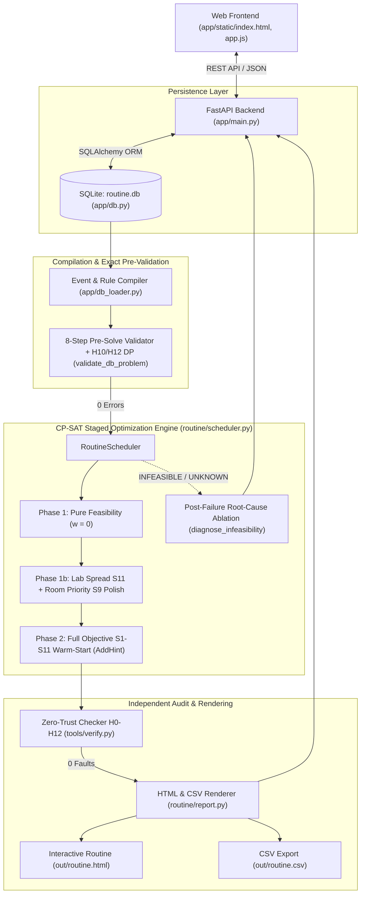
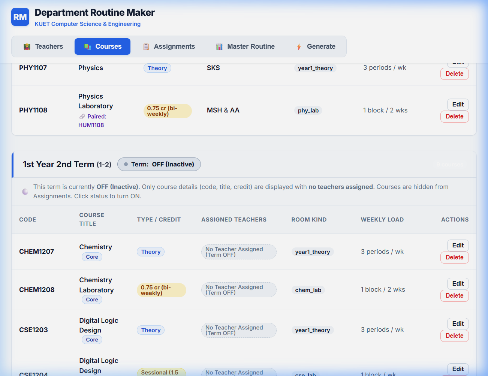
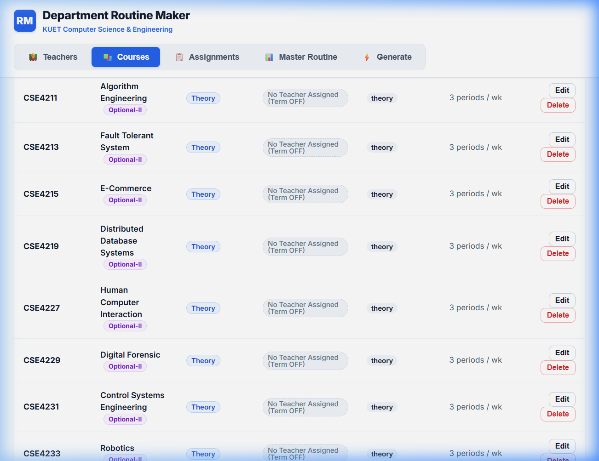
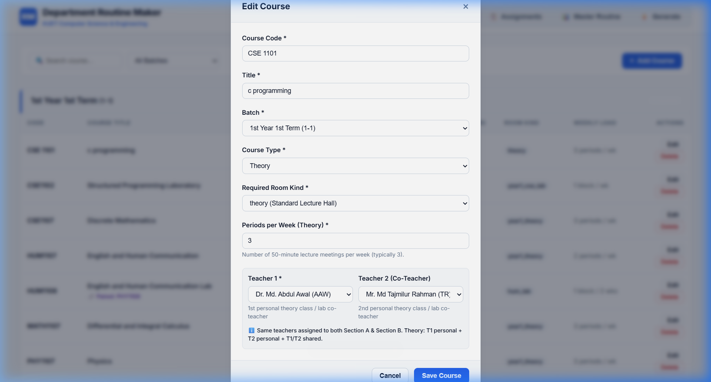
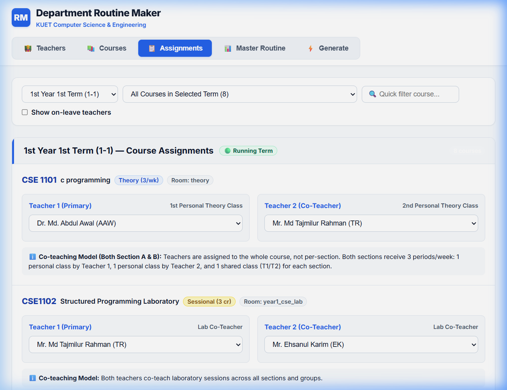
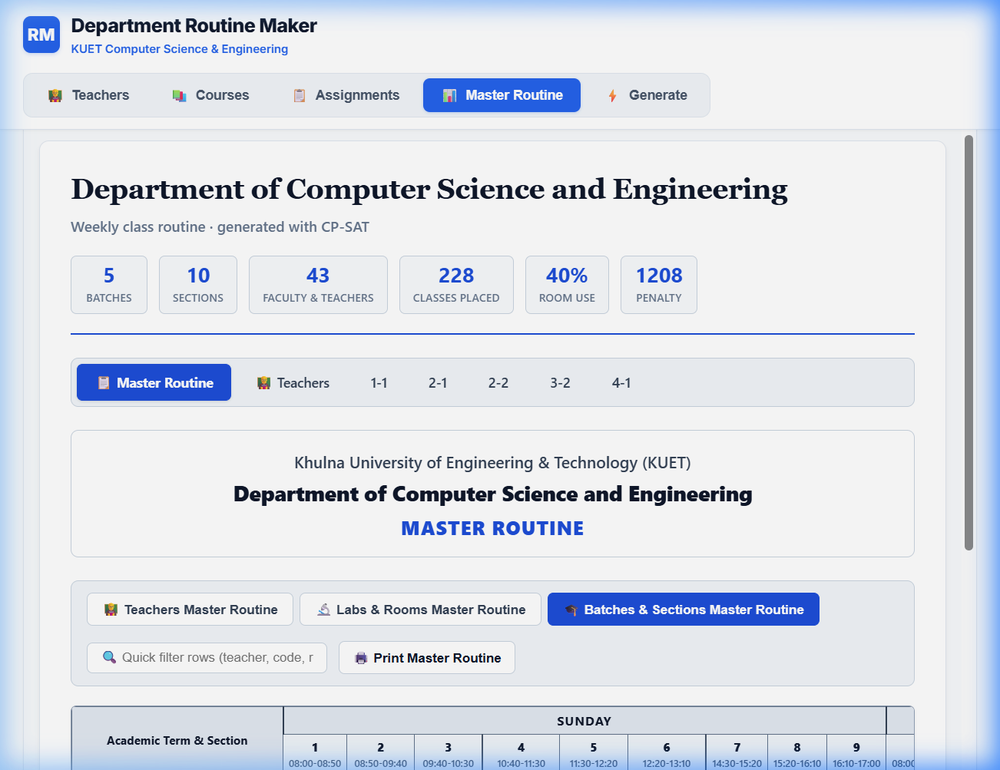
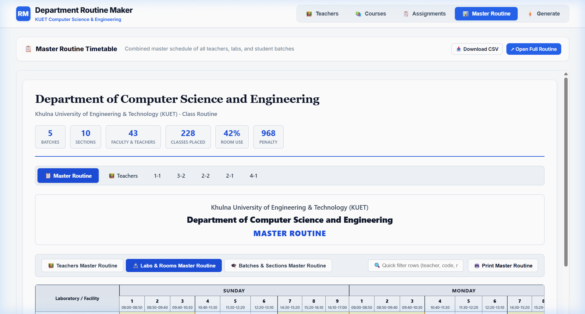
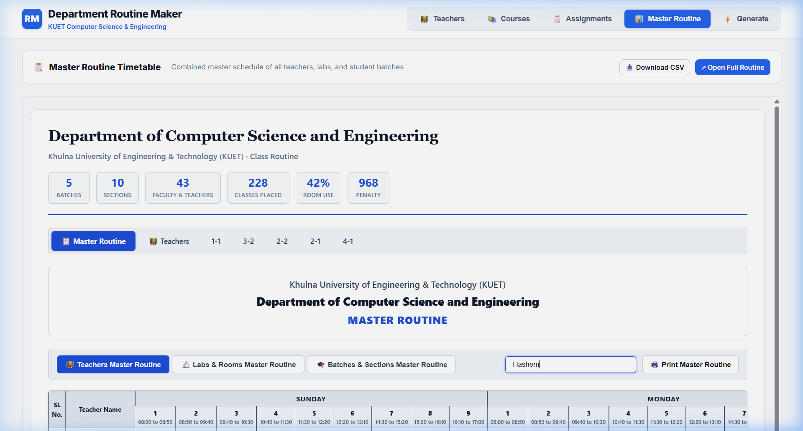
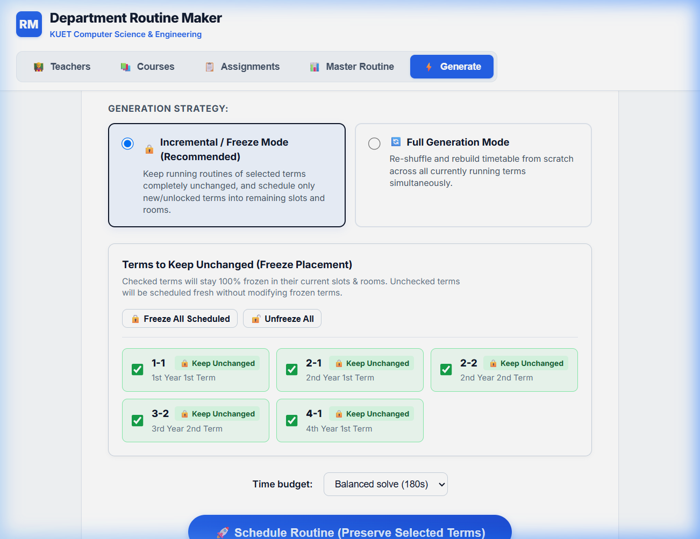
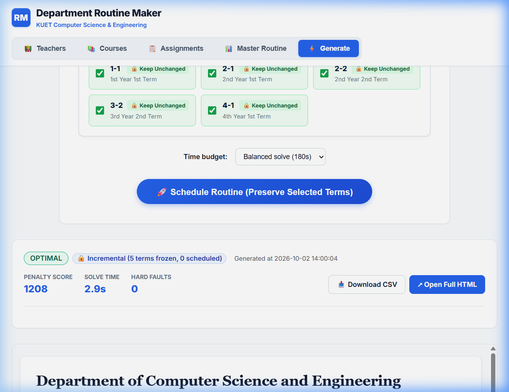

# KUET CSE Class Routine Maker: Comprehensive Technical Documentation & Constraint Reference

**Department of Computer Science and Engineering**  
**Khulna University of Engineering & Technology (KUET)**  
*Automated Class Timetabling System powered by Google OR-Tools CP-SAT*

> **Live Interactive Web Application**: Start the server (`python run_app.py --port 8000`) and open [http://localhost:8000](http://localhost:8000/) to configure faculty, courses, constraints, and generate verified timetables interactively.

---

## Table of Contents
1. [Executive Overview & System Architecture](#1-executive-overview--system-architecture)
2. [End-to-End System Workflow](#2-end-to-end-system-workflow)
3. [Core Features & Operational Constraints Overview](#3-core-features--operational-constraints-overview)
   - 3.1 [Faculty Management & Manual Slot Flexibility (Constraint 1 & H12/S11)](#31-faculty-management--manual-slot-flexibility-constraint-1--h12s11)
   - 3.2 [Academic Curriculum, Special Courses & Slot Rules (Constraint 3 / H11)](#32-academic-curriculum-special-courses--slot-rules-constraint-3--h11)
   - 3.3 [Dynamic Term Status Control (`ON` vs `OFF`)](#33-dynamic-term-status-control-on-vs-off)
   - 3.4 [Course Assignment, Co-Teaching & Batch Scoping (H8)](#34-course-assignment-co-teaching--batch-scoping-h8)
   - 3.5 [Master Routine & Multi-Perspective Viewing](#35-master-routine--multi-perspective-viewing)
   - 3.6 [Incremental / Freeze Routine Generation](#36-incremental--freeze-routine-generation)
   - 3.7 [Pre-Solve Validation, Ablation Diagnostics & Independent Verification](#37-pre-solve-validation-ablation-diagnostics--independent-verification)
   - 3.8 [Project & Thesis (`CSE 3200` / `CSE 4000`) & Joint Seminar (`CSE 3230`)](#38-project--thesis-cse-3200--cse-4000--joint-seminar-cse-3230)
4. [Mathematical Formulation & CP-SAT Implementation Logic](#4-mathematical-formulation--cp-sat-implementation-logic)
   - 4.1 [Time Grid, Contiguous Blocks & Break Boundaries](#41-time-grid-contiguous-blocks--break-boundaries)
   - 4.2 [Domain Pruning, Decision Variables & $O(1)$ Coverage Indexing](#42-domain-pruning-decision-variables--o1-coverage-indexing)
   - 4.3 [All Hard Constraints & Pins (`H0`–`H12` & `Freeze`)](#43-all-hard-constraints--pins-h0h12--freeze)
   - 4.4 [Academic & Domain Event Compilation Rules](#44-academic--domain-event-compilation-rules)
   - 4.5 [All Soft Constraints (`S1`–`S11`) & Objective Function](#45-all-soft-constraints-s1s11--objective-function)
   - 4.6 [Three-Stage Warm-Start Solving Pipeline](#46-three-stage-warm-start-solving-pipeline)
   - 4.7 [Exact Pre-Solve Validator & Root-Cause Ablation Engine](#47-exact-pre-solve-validator--root-cause-ablation-engine)
   - 4.8 [Independent Zero-Trust Verification Auditor](#48-independent-zero-trust-verification-auditor)
5. [Visual Walkthrough & Feature Verification](#5-visual-walkthrough--feature-verification)
6. [Operational Scenario: Preserving Running Routines](#6-operational-scenario-preserving-running-routines)
7. [Constraint Quick-Reference Matrix & Summary](#7-constraint-quick-reference-matrix--summary)

---

## 1. Executive Overview & System Architecture

The **KUET CSE Class Routine Maker** solves the NP-hard departmental University Timetabling Problem (UTP) using **Google OR-Tools CP-SAT**. Rather than relying on heuristic swaps that break when constraints interact tightly, the system encodes all institutional rules as an exact constraint satisfaction and linear optimization program backed by a mathematical pre-solve prover and a post-solve ablation diagnostician.

Key institutional requirements handled natively:
- Simultaneous scheduling of active undergraduate batches (`1-1` through `4-2`) across Sections `A`/`B` and Lab Groups `G1`/`G2`.
- **Constraint 1**: Per-teacher daily/weekly slot unavailability matrices plus full-week `on_leave` blocking.
- **Constraint 2**: Hard prohibition of consecutive different-course classes for any teacher (`H10`), paired with an objective bonus rewarding back-to-back classes of the exact same course (`S10`).
- **Constraint 3**: Course-wide and section-specific allowed/blocked slot pinning for non-departmental courses (`CHEM`, `PHY`, `MATH`, `EEE`, `ME`, `ECE`, `HUM`, `IEM`) and fixed lab slots (`H11`).
- **Teacher Daily Lab Cap**: Strict ceiling of at most 2 lab sessions per day per teacher (`H12`, never capping student cohorts) with a strong soft incentive to spread teachers to $\le 1$ lab session per day (`S11`).
- Co-teaching splits (`T1`, `T2`, `T1/T2` shared), homeroom binding, conditional group-lab sync (`H9`), bi-weekly alternating `0.75`-credit lab synchronization, roomless project/thesis courses (`CSE 3200`/`CSE 4000`), and zero-disruption **Incremental / Freeze Mode**.

### System Architecture Diagram



---

## 2. End-to-End System Workflow

Timetable generation executes through a deterministic 8-stage pipeline inside [`generate_routine`](file:///f:/routine_maker/app/main.py#L1417-L1571):

1. **Faculty & Availability Configuration**: Teachers are configured in SQLite ([`Teacher`](file:///f:/routine_maker/app/db.py#L18-L30), [`TeacherUnavailable`](file:///f:/routine_maker/app/db.py#L93-L101)) with short codes, departments, `max_periods_per_day`, status (`active` / `on_leave`), and daily/weekly unavailable slot rules.
2. **Curriculum & Course Slot Rules**: Batches `1-1` through `4-2`, rooms, lab pairings, and per-course/per-section slot whitelists or blacklists ([`CourseSlotRule`](file:///f:/routine_maker/app/db.py#L103-L115)) are stored.
3. **Term Activation & Teacher Assignments**: Only batches toggled `status='on'` are compiled into active scheduling events. Faculty assignments (`teacher1_id`, `teacher2_id`) automatically activate chosen `optional_ii` / `optional_iii` electives.
4. **Domain Compilation**: [`load_problem_from_db`](file:///f:/routine_maker/app/db_loader.py#L175-L404) compiles active database rows into [`Problem`](file:///f:/routine_maker/routine/models.py#L129-L252), [`Course`](file:///f:/routine_maker/routine/models.py#L45-L81), and [`Event`](file:///f:/routine_maker/routine/models.py#L84-L126) objects via [`_build_events`](file:///f:/routine_maker/app/db_loader.py#L406-L655), applying Constraint 1 & Constraint 3 rule intersections.
5. **Exact Mathematical Pre-Validation**: [`validate_db_problem`](file:///f:/routine_maker/app/db_loader.py#L851-L1148) runs 8 soundness checks—including Kuhn bipartite matchings for `H4` & `H12` and an exact per-day bitmask + cross-day dynamic programming proof ([`_max_teacher_capacity_under_h4_h10`](file:///f:/routine_maker/app/db_loader.py#L678-L849))—rejecting mathematically impossible inputs immediately with actionable messages.
6. **Incremental Freeze Pinning & Staged CP-SAT Solve**:
   - In **Incremental Mode**, prior placements for selected frozen batches are loaded from `scheduled_assignments` ([`get_saved_placements_map`](file:///f:/routine_maker/app/db.py#L529-L539)) and pinned via `_c_freeze`.
   - [`solve_routine`](file:///f:/routine_maker/routine/scheduler.py#L826-L911) executes Phase 1 (feasibility), Phase 1b (lab-spread & room-priority warm polish), and Phase 2 (full 11-term objective optimization).
7. **Failure Diagnostics (if unsolvable)**: If no solution is found, [`diagnose_infeasibility`](file:///f:/routine_maker/routine/scheduler.py#L968-L1123) runs controlled relaxation probes (`_quick_phase1_ok`) to pinpoint the exact frozen batch, overloaded teacher (`H10`/`H12`), Constraint 3 rule, Constraint 1 rule, or `H9` conflict.
8. **Zero-Trust Verification & Output Generation**: [`tools/verify.py`](file:///f:/routine_maker/tools/verify.py#L26-L277) independently checks `H0`–`H12`, after which placements commit to `scheduled_assignments` and render to `out/routine.html` and `out/routine.csv`.

---

## 3. Core Features & Operational Constraints Overview

### 3.1 Faculty Management & Manual Slot Flexibility (Constraint 1 & H12/S11)
- **Teacher Profiles & Daily Ceilings**: Managed in [`Teacher`](file:///f:/routine_maker/app/db.py#L18-L30) with short code, department (`CSE`, `ECE`, `EEE`, `MATH`, `PHY`, `CHEM`, `HUM`, `ME`, `IEM`), `status` (`active` or `on_leave`), and `max_periods_per_day` (soft threshold used in `S4` and hard weekly upper bound `max_periods_per_day * 5`).
- **Constraint 1 (Manual Slot Unavailability)**:
  - **Daily restrictions**: `day = "daily"` (or `"all"` / `"*"`), e.g. `P1,P2,P3` blocks 08:00–10:30 AM across Sunday–Thursday.
  - **Weekly day-specific restrictions**: e.g. Monday `P1,P2,P3` and Tuesday `P7,P8,P9`.
  - **On-Leave toggle**: Setting `status="on_leave"` expands blocked slots to all 45 slots (`0..44`).
  - Rendered with hatched `"Off"` indicators on both the Teachers Master Routine and individual teacher cards ([`routine/report.py#L547-L553`](file:///f:/routine_maker/routine/report.py#L547-L553)).
- **Teacher Daily Lab Workload Cap (H12 & S11)**:
  - **Hard Constraint H12**: No teacher is ever assigned more than `max_teacher_labs_per_day = 2` lab sessions on the same day.
  - **Soft Constraint S11**: Strongly rewards placing at most `1` lab session per day per teacher whenever weekly lab counts and slot rules permit (`weight = 120`).
  - **Student Exemption**: Intentionally scoped **exclusively to faculty**; student cohorts remain unrestricted per day so multi-lab student days can still pack legally.

### 3.2 Academic Curriculum, Special Courses & Slot Rules (Constraint 3 / H11)
- **Full 8-Term Catalog**: Canonical order `CURRICULUM_ORDER = ["1-1", "1-2", "2-1", "2-2", "3-1", "3-2", "4-1", "4-2"]`.
- **Constraint 3 (Course-Specific & Fixed Slots)**:
  - Stored in [`CourseSlotRule`](file:///f:/routine_maker/app/db.py#L103-L115) with `rule_type` (`"allowed"` whitelist or `"blocked"` blacklist) and optional `section` scoping (`None`/`"ALL"`, `"A"`, or `"B"`).
  - Designed especially for non-departmental courses (`CHEM1207`/`1208`, `PHY1107`/`1108`, `MATH1207`/`2107`, `EEE1208`/`2118`, `ME2170`, `ECE2214`, `HUM1108`/`3247`, `IEM4227`) whose slots are fixed externally.
  - Paired 0.75-credit sessional labs automatically synchronize the intersection of `allowed_slots` and union of `blocked_slots` ([`app/db_loader.py#L640-L654`](file:///f:/routine_maker/app/db_loader.py#L640-L654)).

### 3.3 Dynamic Term Status Control (`ON` vs `OFF`)
- Only batches with `Batch.status == "on"` are loaded by [`load_problem_from_db`](file:///f:/routine_maker/app/db_loader.py#L197-L216).
- Toggling inactive terms `OFF` hides them from active assignments and scheduling while preserving syllabus rows and saved placements for future terms.

### 3.4 Course Assignment, Co-Teaching & Batch Scoping (H8)
- **Theory Co-Teaching**: Assigning `Teacher 1` and `Teacher 2` compiles 3 weekly lectures into:
  - Meeting 1 (`k=0`): `[T1]` individual
  - Meeting 2 (`k=1`): `[T2]` individual
  - Meeting 3 (`k>=2`): `[T1, T2]` joint shared class (`is_shared=True`)
- **H8 Batch-Scoped Theory Limit**: Within any single active batch (`1-1`..`4-2`), a teacher may hold **at most one theory course** (checked across both primary and co-teachers). A teacher *may*, however, teach theory courses in different batches (e.g., 2nd Year and 4th Year).

### 3.5 Master Routine & Multi-Perspective Viewing
- Generates synchronized views in [`routine/report.py`](file:///f:/routine_maker/routine/report.py): **Teachers Master Routine**, **Labs & Rooms Master Routine**, **Batches & Sections Master Routine**, plus printable individual faculty/section sheets and `"⚡ Same Course"` badges highlighting Constraint 2 (`S10`) back-to-back classes.

### 3.6 Incremental / Freeze Routine Generation
- Selected active batches with existing `scheduled_assignments` rows are pinned as equality constraints ($x_{e, r^*, s^*} = 1$) while newly activated/unfrozen terms fill the remaining legal capacity around them.

### 3.7 Pre-Solve Validation, Ablation Diagnostics & Independent Verification
- Pre-solve mathematical prover stops guaranteed-unsolvable inputs in milliseconds before solver search starts; post-failure ablation pinpoints culprit constraints or teachers automatically; [`tools/verify.py`](file:///f:/routine_maker/tools/verify.py) audits all 13 hard constraints independently.

### 3.8 Project & Thesis (`CSE 3200` / `CSE 4000`) & Joint Seminar (`CSE 3230`)
- **`CSE 3200` (3-2, 1.5 cr, 1 block/wk)** and **`CSE 4000` (4-1 1.5 cr 1 block/wk; 4-2 3.0 cr 2 distinct-day blocks/wk)**: Section-wide (`group=None`), zero central teachers (`teacher_ids=[]`), virtual room `NO_ROOM` (`room_kind="no_room"`), excluded from physical room conflicts, lab-cap checks (`H10`, `H12`), and the Rooms Master table.
- **`CSE 3230` (Technical Writing and Seminar, 0.75 cr)**: Compiled as a single joint event (`section="A/B"`, occupying all cohorts of both sections simultaneously) scheduled exclusively inside `CSE-501` (`room_kind="seminar_501"`), with room demand folded into `theory` utilization accounting.

---

## 4. Mathematical Formulation & CP-SAT Implementation Logic

The optimization model is constructed inside [`RoutineScheduler`](file:///f:/routine_maker/routine/scheduler.py#L63-L820) over [`TimeGrid`](file:///f:/routine_maker/routine/timegrid.py#L39-L184) and [`Problem`](file:///f:/routine_maker/routine/models.py#L129-L252).

### 4.1 Time Grid, Contiguous Blocks & Break Boundaries

Implemented in [`routine/timegrid.py`](file:///f:/routine_maker/routine/timegrid.py#L39-L184) with default KUET CSE topology defined in [`app/db_loader.py#L40-L55`](file:///f:/routine_maker/app/db_loader.py#L40-L55):

- **Days ($D$)**: $\{0, 1, 2, 3, 4\} \leftrightarrow [\text{Sunday}, \text{Monday}, \text{Tuesday}, \text{Wednesday}, \text{Thursday}]$, $n_{\text{days}} = 5$.
- **Periods ($P$)**: $\{0, 1, \dots, 8\} \leftrightarrow [\text{P1}, \text{P2}, \dots, \text{P9}]$, $n_{\text{periods}} = 9$ (each 50 minutes).
- **Flat Slot Index ($S$)**: 45 discrete atomic slots $s \in \{0, 1, \dots, 44\}$:
  $$\text{slot}(d, p) = d \cdot 9 + p, \qquad d = \lfloor s / 9 \rfloor, \quad p = s \bmod 9$$

| Period | Index ($p$) | Time Window | Block Assignment |
|:---|:---:|:---|:---|
| `P1`, `P2`, `P3` | `0, 1, 2` | `08:00–08:50`, `08:50–09:40`, `09:40–10:30` | **Block 1** `[0, 1, 2]` |
| *Snack Break* | — | `10:30–10:40` (10 min break after `P3`) | *Hard block cut* |
| `P4`, `P5`, `P6` | `3, 4, 5` | `10:40–11:30`, `11:30–12:20`, `12:20–13:10` | **Block 2** `[3, 4, 5]` |
| *Lunch & Prayer* | — | `13:10–14:30` (80 min break after `P6`) | *Hard block cut* |
| `P7`, `P8`, `P9` | `6, 7, 8` | `14:30–15:20`, `15:20–16:10`, `16:10–17:00` | **Block 3** `[6, 7, 8]` |

[`TimeGrid._compute_blocks`](file:///f:/routine_maker/routine/timegrid.py#L69-L88) partitions period indices into `self.blocks = [[0, 1, 2], [3, 4, 5], [6, 7, 8]]`. Every 3-period sessional (`lab_periods = 3`) has start domain [`lab_start_slots`](file:///f:/routine_maker/routine/timegrid.py#L123-L135) restricted to $\{d \cdot 9 + 0, \; d \cdot 9 + 3, \; d \cdot 9 + 6\}_{d=0}^{4}$ (15 legal block starts across the week).

---

### 4.2 Domain Pruning, Decision Variables & $O(1)$ Coverage Indexing

Implemented in [`RoutineScheduler._create_variables`](file:///f:/routine_maker/routine/scheduler.py#L115-L180):

1. **Pruned Variable Creation (No Dead Variables)**:
   Before instantiating any CP-SAT variable for event $e \in E$, the model calls [`Problem.feasible_rooms(e)`](file:///f:/routine_maker/routine/models.py#L163-L230) (intersected with home-room pinning for theory classes) to obtain $R_e$, and [`Problem.feasible_starts(e)`](file:///f:/routine_maker/routine/models.py#L232-L252) (already pruned for breaks, teacher unavailability, and Constraint 3 course rules) to obtain $S_e$.
   For every $(r, s) \in R_e \times S_e$:
   $$x_{e, r, s} \in \{0, 1\} \iff \text{event } e \text{ starts in room } r \text{ at flat slot } s$$
2. **Start-Slot Channeling Variable**:
   $$S_e \in \{0, \dots, 44\}, \qquad S_e = \sum_{r \in R_e} \sum_{s \in S_e} s \cdot x_{e, r, s}$$
   Used directly for compact integer equality/inequality constraints (`H4` symmetry ordering and `H9` synchronization).
3. **$O(1)$ Coverage Dictionaries (`cover` & `cover_room`)**:
   Because multi-period labs occupy $s, s+1, s+2$, scanning all variables per slot $t$ would scale quadratically. Instead, [`_create_variables`](file:///f:/routine_maker/routine/scheduler.py#L168-L176) builds lookup buckets once:
   - `self.cover[ev.eid][t]` = all literals $x_{e, r, s}$ with $s \le t < s + \text{length}(e)$
   - `self.cover_room[ev.eid][(rid, t)]` = all literals $x_{e, rid, s}$ occupying room `rid` at slot `t`
4. **Derived Boolean Occupancy Indicators**:
   - Cohort occupancy `self.cohort_busy[ck][t]` $\in \{0, 1\}$ (`cbusy`)
   - Teacher occupancy `self.teacher_busy[tid][t]` $\in \{0, 1\}$ (`tbusy`)

---

### 4.3 All Hard Constraints & Pins (`H0`–`H12` & `Freeze`)

Every schedule accepted by the system satisfies **all 13 hard rules (`H0`–`H12`)** plus optional Freeze pins.

#### H0: Exact Placement (Completeness)
- **Rule**: Every compiled active event must be assigned to exactly one legal `(room, start_slot)` pair.
- **Formulation**:
  $$\sum_{r \in R_e} \sum_{s \in S_e} x_{e, r, s} = 1, \quad \forall e \in E$$
- **Implementation**: Enforced via `AddExactlyOne(cells.values())` in [`_create_variables`](file:///f:/routine_maker/routine/scheduler.py#L157) (`raise ValueError` if domain empty); audited in [`tools/verify.py#L30-L33`](file:///f:/routine_maker/tools/verify.py#L30-L33).

---

#### H1: Student Cohort Non-Overlap (Zero Student Clashes)
- **Rule**: No student subgroup $(b, \text{sec}, g)$ can attend two classes simultaneously.
- **Cohort Expansion Logic** ([`Problem.cohorts_of`](file:///f:/routine_maker/routine/models.py#L152-L162)):
  - Standard/project theory or `group=None` events occupy **all** groups $\{(b, \text{sec}, g) : g \in G_b\}$.
  - Joint `CSE 3230` (`section="A/B"`) occupies **every** `(section, group)` cohort in the batch.
  - Standalone bi-weekly 0.75-cr labs (`group="G1/G2"`) split on `"/"` so they occupy both `G1` and `G2`.
  - Standard/paired group labs occupy only their single `(batch, sec, group)`.
- **Formulation**:
  $$b^{\text{coh}}_{c, t} = \sum_{e \in E : c \in \text{cohorts}(e)} \sum_{x \in \text{cover}[e][t]} x, \qquad b^{\text{coh}}_{c, t} \in \{0, 1\}, \quad \forall c \in C, \; \forall t \in [0, 44]$$
  Declaring $b^{\text{coh}}_{c,t}$ as a `BoolVar` and setting `Add(b == sum(lits))` simultaneously enforces both mutual exclusion ($\le 1$) and defines the busy indicator used by soft constraints `S1`, `S3`, `S5`, and `S8`.
- **Code Reference**: [`_c_cohort_conflicts`](file:///f:/routine_maker/routine/scheduler.py#L183-L206).
  ```python
  b = self.model.NewBoolVar(f"cbusy_{ck}_{t}")
  self.model.Add(b == sum(lits) if lits else b == 0)
  ```

---

#### H2: Teacher Non-Overlap (Zero Faculty Clashes)
- **Rule**: No teacher can appear in two classrooms or labs at the same time (including co-taught shared lectures `[T1, T2]` and joint labs).
- **Formulation**:
  $$b^{\text{tch}}_{T, t} = \sum_{e \in E : T \in \text{teachers}(e)} \sum_{x \in \text{cover}[e][t]} x, \qquad b^{\text{tch}}_{T, t} \in \{0, 1\}, \quad \forall T, \; \forall t \in [0, 44]$$
- **Code Reference**: [`_c_teacher_conflicts`](file:///f:/routine_maker/routine/scheduler.py#L207-L231).

---

#### H3: Physical Room Non-Overlap (`NO_ROOM` Excluded)
- **Rule**: Every physical room hosts at most one active event per timeslot; virtual `NO_ROOM` (used by `CSE 3200`/`CSE 4000`) is exempt so multiple student sections can work independently in parallel.
- **Formulation**:
  $$\sum_{e \in E} \sum_{x \in \text{cover\_room}[e][(r, t)]} x \le 1, \quad \forall r \in R \setminus \{\text{NO\_ROOM}, \text{""}\}, \; \forall t \in [0, 44]$$
- **Code Reference**: [`_c_room_conflicts`](file:///f:/routine_maker/routine/scheduler.py#L232-L243) via `AddAtMostOne(lits)`.

---

#### H4: Same Course-Section Distinct-Day Spread & Symmetry Breaking
- **Rule**: Multiple weekly meetings of the same course for the same `(course.code, batch_id, section, group)` cohort—whether a 2/3-period theory course or a 2-block `CSE 4000` (4-2) project—must occur on **strictly distinct days**, and interchangeable sibling `meeting_index` slots are ordered chronologically to eliminate $k!$ identical search permutations.
- **Formulation**:
  $$\sum_{e \in G_k} \sum_{\substack{r \in R_e \\ d \cdot 9 \le s < (d+1) \cdot 9}} x_{e, r, s} \le 1 \quad \forall d \in [0, 4]$$
  $$S_{e_0} < S_{e_1} < \dots < S_{e_{m-1}} \quad \text{(Symmetry break by } \texttt{meeting\_index}\text{)}$$
- **Code Reference**: [`_c_theory_spread_and_symmetry`](file:///f:/routine_maker/routine/scheduler.py#L244-L273).

---

#### H5: Room Type Matching, Homeroom Binding, Specialized Labs & Capacity
- **Rule**: Every event must sit in a room of compatible `room_kind`, meeting `capacity >= size`, obeying fixed specialized room rules and sectional theory homeroom assignments.
- **Implementation Logic** ([`Problem.feasible_rooms`](file:///f:/routine_maker/routine/models.py#L163-L230) & [`_create_variables`](file:///f:/routine_maker/routine/scheduler.py#L116-L147)):
  1. **Project/Thesis (`CSE 3200`, `CSE 4000`, `no_room`)**: Always returns `[NO_ROOM]`.
  2. **Theory Homeroom Binding**: Non-lab theory courses bind deterministically to each section's assigned homeroom via `DEFAULT_HOME_ROOMS` (with fallback to `kind == "theory"` rooms of capacity $\ge \text{size}$):

     | Section Key | Home Room | Section Key | Home Room |
     |:---|:---:|:---|:---:|
     | `1-1\|A`, `1-2\|A` | `CSE-101` | `3-1\|A`, `3-2\|A` | `CSE-401` |
     | `1-1\|B`, `1-2\|B` | `CSE-102` | `3-1\|B`, `3-2\|B` | `CSE-402` |
     | `2-1\|A`, `2-2\|A` | `CSE-105` | `4-1\|A`, `4-2\|A` | `CSE-501` |
     | `2-1\|B`, `2-2\|B` | `CSE-306` | `4-1\|B`, `4-2\|B` | `CSE-502` |

  3. **Dedicated Specialized Course/Lab Bindings**:
     - `CSE3106`, `CSE2104` / `hardware_lab_107` $\to$ `CSE-107`
     - `CSE1204` / `hardware_lab_108` $\to$ `CSE-108`
     - `CSE3230` / `seminar_501` $\to$ `CSE-501`
     - `EEE1208`, `EEE2118` / `eee_lab` $\to$ `EEE-LAB`
     - `ME2170` / `mecha_lab` $\to$ `MECHA-LAB`
     - `ECE2214`, `ECE2208` / `ece_lab` $\to$ `ECE-104`
     - `CHEM1208` / `chem_lab` $\to$ `CHEM-LAB`
     - `HUM1108` / `hum_lab` $\to$ `HUM-LAB`
     - `PHY1108` / `phy_lab` $\to$ `PHY-LAB`
  4. **Software Lab Pool** (`cse_lab`, `year1_cse_lab`, `ai_lab`, `network_lab`): Candidate set `["CSE-103", "CSE-104", "CSE-201", "CSE-202", "CSE-305", "CSE-306"]` (regulated softly by `S9` so `CSE-306` acts only as overflow).

---

#### H6: Single-Day & Break-Free Contiguous Block Containment
- **Rule**: No event may span midnight, exit the 45-slot week, or straddle the Snack Break (`P3`$\to$`P4`) or Lunch Break (`P6`$\to$`P7`).
- **Implementation**: Structural domain pruning via [`TimeGrid.lab_start_slots`](file:///f:/routine_maker/routine/timegrid.py#L123-L135) restricts multi-period labs solely to `{0, 3, 6} + 9d`, making break-crossing variables nonexistent; verified in [`tools/verify.py#L85-L96`](file:///f:/routine_maker/tools/verify.py#L85-L96).

---

#### H7: Manual Teacher Slot Flexibility & Leave Status (Constraint 1)
- **Rule**: A teacher cannot teach in any slot in their blocked set $U(T)$, populated from daily/weekly `TeacherUnavailable` records plus `status == "on_leave"` ($U(T) = \{0..44\}$).
- **Rule Compilation** ([`app/db_loader.py#L228-L272`](file:///f:/routine_maker/app/db_loader.py#L228-L272)):
  - `day in ("all", "daily", "*")` expands across all 5 days $d \in [0, 4]$; named days expand to that day index.
  - `periods in ("all", "*")` expands across all 9 periods $p \in [0, 8]$; comma lists like `"P1,P2,P3"` map period tokens via `TimeGrid.slot(d, p)`.
- **Dual Enforcement**:
  1. Domain pruning in [`Problem.feasible_starts`](file:///f:/routine_maker/routine/models.py#L242-L244): drops any start $s$ whose covered interval intersects $U(T)$ before variables are built.
  2. Explicit guard in [`_c_teacher_conflicts`](file:///f:/routine_maker/routine/scheduler.py#L223-L226): enforces `lit == 0` and `tbusy[T][t] == 0` for all $t \in U(T)$.

---

#### H8: One Theory Course per Batch per Teacher
- **Rule**: Within the same active batch $b$, each teacher can be assigned at most **one** distinct theory course (checked across both `teacher1_id` and `teacher2_id`). Teaching theory courses in *separate* batches is allowed.
- **Formulation**:
  $$\left| \left\{ c.\text{code} : c \in \text{Courses}(b, \text{THEORY}) \land T \in \{T_1(c), T_2(c)\} \right\} \right| \le 1, \quad \forall T, \; \forall b$$
- **Implementation**: Checked upfront in [`validate_db_problem`](file:///f:/routine_maker/app/db_loader.py#L920-L936) (`H8 Violation`) and audited post-solve in [`tools/verify.py#L136-L150`](file:///f:/routine_maker/tools/verify.py#L136-L150).

---

#### H9: Conditional Lab Group Sync & Paired 0.75-Credit Lab Sync
Implemented across two complementary methods in [`routine/scheduler.py`](file:///f:/routine_maker/routine/scheduler.py#L274-L335):

1. **Conditional Group Lab Sync (`G1` vs `G2`)** ([`_c_sync_group_labs`](file:///f:/routine_maker/routine/scheduler.py#L274-L324)):
   When `sync_group_labs=True`, for any lab group bundle `(course.code, batch_id, section, meeting_index)` with events $\{e_1, \dots, e_k\}$, the solver locks:
   $$S_{e_1} = S_{e_2} = \dots = S_{e_k}$$
   **only if BOTH physical prerequisites hold**:
   - **Room Supply Sufficiency**: Number of physical rooms of kind `ev.room_kind` is $\ge |\{e_i\}|$ (single-room labs like `CSE-107`, `CSE-108`, `CHEM-LAB`, `EEE-LAB`, `ECE-104`, `MECHA-LAB` have supply `1 < 2`, so they automatically skip hard sync and stagger safely).
   - **Disjoint Group Teachers**: None of the events in the bundle share a teacher ID (if a co-teaching pair `T1 + T2` runs both `G1` and `G2` of a CSE lab, syncing them would directly violate `H2`; the solver detects the shared teacher and staggers them instead).
   Exempted courses are logged in `Solution.unsynced_courses` and identically exempted by [`tools/verify.py#L156-L199`](file:///f:/routine_maker/tools/verify.py#L156-L199).

2. **Bi-Weekly Paired 0.75-Credit Sync** ([`_c_sync_paired_labs`](file:///f:/routine_maker/routine/scheduler.py#L325-L335)):
   Whenever two `0.75`-cr courses are mutually paired (`paired_course_id`, e.g. `HUM1108` $\leftrightarrow$ `PHY1108`, `CSE3106` $\leftrightarrow$ `CSE3120`), Event A (`G1`) and Event B (`G2`) have symmetric `paired_event_id` links and are unconditionally locked to the exact same start slot:
   $$S_{e_A} = S_{e_B}$$

---

#### H10: Prohibition of Teacher Consecutive Different-Course Classes (Constraint 2 Hard Rule)
- **Rule**: A teacher must **never** be scheduled for two consecutive periods belonging to *different* courses on the same day within continuous school hours (excluding roomless `CSE 3200` and `CSE 4000`).
- **Continuous Adjacent Period Pairs (`adjacent_pairs`)**:
  $$A_{\text{pairs}} = \{(0,1), (1,2), \underbrace{(2,3)}_{\text{Snack Break}}, (3,4), (4,5), (6,7), (7,8)\}$$
  - Spans the 10-minute morning Snack Break (`P3`$\to$`P4`), forbidding different courses immediately before and after Snack Break.
  - Excludes `(5,6)` (`P6`$\to$`P7`, 80-minute Lunch & Prayer Break) by default; included only when `teacher_consecutive_include_lunch=True`.
- **Implementation Logic 1 — Positive-Literal Cliques** ([`_c_teacher_diff_course_consecutive`](file:///f:/routine_maker/routine/scheduler.py#L358-L421)):
  Rather than writing a weak cancellation inequality ($u_{T,c,t_1} + b_{T,t_2} - u_{T,c,t_2} \le 1$, where $+b$ and $-u$ cancel in LP relaxations), the solver explicitly builds a **direct positive-literal mutex clique** for every teacher $T$, every course $c$ taught by $T$, every day $d$, and every $(p_1, p_2) \in A_{\text{pairs}}$:
  Let $t_1 = 9d + p_1$, $t_2 = 9d + p_2$:
  $$\text{AddAtMostOne}\!\left( L_{T, c}(t_1) \;\cup\; \bigcup_{c' \ne c} L_{T, c'}(t_2) \right)$$
  where $L_{T,c}(t)$ collects all placement literals $x_{e,r,s}$ of course $c$ assigned to $T$ whose interval covers slot $t$. This gives CP-SAT direct clique propagation without slack cancellation.
- **Implementation Logic 2 — Sound Implied Block-Capacity Cut (`H2 + H4 + H10`)** ([`routine/scheduler.py#L422-L454`](file:///f:/routine_maker/routine/scheduler.py#L422-L454)):
  Inside any 3-period academic block $B = [p_a, p_a+1, p_a+2]$, every period is contiguous with its neighbor. By `H10`, all active periods inside $B$ must belong to a **single course** $c$. By `H4` (distinct-day spread), at most one meeting per distinct `(batch, section, group)` cohort of $c$ can land in $B$. Therefore, if **no** theory course taught by $T$ has $\ge |B| = 3$ distinct cohorts able to land in $B$, a non-lab block can hold **at most $|B| - 1 = 2$ theory periods** (and 0 if a 3-period lab occupies $B$). The solver injects this tight implied cut directly:
  $$\sum_{s \in B_d} \sum_{x \in \text{th\_lits}(T, s)} x \;+\; (|B| - 1) \sum_{x \in \text{lab\_starts}(T, B_d[0])} x \;\le\; |B| - 1$$
  Because standard KUET batches each have 2 sections (`A` and `B`), this valid cut dramatically tightens CP-SAT's dual bound whenever teachers are near full capacity.

---

#### H11: Course Slot Availability & Fixed Slot Pinning (Constraint 3)
- **Rule**: Every meeting of an optionally restricted course must lie wholly inside its intersection of course-level and section-level `allowed_slots` (if non-empty) and completely outside all `blocked_slots`.
- **Rule Merging Logic** ([`app/db_loader.py#L620-L654`](file:///f:/routine_maker/app/db_loader.py#L620-L654)):
  1. `ev.blocked_slots = course.blocked_slots | course.section_blocked_slots.get(sec, set())`.
  2. If both course-wide and section-specific `allowed` rules exist, `ev.allowed_slots = sec_allowed & course.allowed_slots`; otherwise whichever non-empty set is provided becomes `ev.allowed_slots`.
  3. **Paired 0.75-cr Synchronization**: For paired labs `(e, e')`, slot rules synchronize symmetrically so `H9` / paired lock remains consistent:
     $$B_{\text{sync}} = B_e \cup B_{e'}, \qquad A_{\text{sync}} = \begin{cases} A_e \cap A_{e'} & \text{if } A_e \ne \emptyset \land A_{e'} \ne \emptyset \\ A_e \cup A_{e'} & \text{otherwise} \end{cases}$$
- **Constraint Enforcement** ([`Problem.feasible_starts`](file:///f:/routine_maker/routine/models.py#L245-L251)):
  $$S_e = \left\{ s \in \text{BaseStarts}(e) \;\middle|\; \text{cov}(s) \cap B_e = \emptyset \;\land\; \big(A_e = \emptyset \lor \text{cov}(s) \subseteq A_e\big) \right\}$$
  Zero-weight variable-domain elimination prevents any invalid variable $x_{e,r,s}$ from being created. Audited in [`tools/verify.py#L233-L253`](file:///f:/routine_maker/tools/verify.py#L233-L253).

---

#### H12: Teacher Maximum Daily Lab Session Limit (`max_teacher_labs_per_day = 2`)
- **Rule**: A teacher may conduct **at most 2 lab sessions per day** (`max_teacher_labs_per_day = 2`).
- **Scope**:
  - Applies **strictly to teachers**, **NOT** to student cohorts (student cohorts remain free to attend multiple labs on the same day if needed).
  - Excludes roomless project/thesis events (`CSE 3200`, `CSE 4000`).
  - Deduplicates `ev.teacher_ids` via `dict.fromkeys` so co-teaching teachers are each counted once per session.
- **Formulation**:
  Let $L(T)$ be all active lab events assigned to teacher $T$ (with $M_{\text{lab}} = 2$). For each teacher with $|L(T)| > M_{\text{lab}}$ and each day $d \in [0, 4]$:
  $$\sum_{e \in L(T)} \sum_{r \in R_e} \sum_{\substack{s \in S_e \\ 9d \le s < 9(d+1)}} x_{e, r, s} \le M_{\text{lab}}$$
- **Code Reference**: [`_c_teacher_max_labs_per_day`](file:///f:/routine_maker/routine/scheduler.py#L456-L493), pre-validated in [`validate_db_problem`](file:///f:/routine_maker/app/db_loader.py#L1073-L1103), and audited in [`tools/verify.py#L254-L276`](file:///f:/routine_maker/tools/verify.py#L254-L276).

---

#### Incremental / Freeze Pinning Constraint
- **Rule**: In Incremental Mode, every event $e$ belonging to a frozen batch is locked to its database placement $(r^*, s^*)$ from `scheduled_assignments`.
- **Formulation**:
  $$x_{e, r^*, s^*} = 1, \quad \forall e \in E_{\text{frozen}}$$
- **Code Reference**: [`_c_freeze`](file:///f:/routine_maker/routine/scheduler.py#L336-L357) (falls back to `("NO_ROOM", s^*)` if mapped, or raises `FREEZE_CONFLICT` if edited teacher/course/room rules made $(r^*, s^*)$ illegal).

---

### 4.4 Academic & Domain Event Compilation Rules

[`load_problem_from_db`](file:///f:/routine_maker/app/db_loader.py#L175-L404) and [`_build_events`](file:///f:/routine_maker/app/db_loader.py#L406-L655) enforce structural curriculum rules during event construction:

| Rule / Course Pattern | Compilation Behavior | Code Location |
|:---|:---|:---|
| **Elective Gating (`optional_ii`, `optional_iii`)** | Skipped entirely unless `teacher1_id`, `teacher2_id`, or `Assignment` rows are configured for that elective. | [`app/db_loader.py#L320-L322`](file:///f:/routine_maker/app/db_loader.py#L320-L322) |
| **Theory Co-Teaching (`T1`, `T2`)** | For `periods_per_week` meetings $k=0,1,2$: $k=0 \to [T_1]$, $k=1 \to [T_2]$, $k \ge 2 \to [T_1, T_2]$ (`is_shared=True`). | [`app/db_loader.py#L480-L508`](file:///f:/routine_maker/app/db_loader.py#L480-L508) |
| **Weekly Labs (`1.5` or `3.0` cr)** | One event per `(section, group, meeting_index)` of length `3`, co-taught by both assigned lab teachers (`[T1, T2]`). | [`app/db_loader.py#L595-L618`](file:///f:/routine_maker/app/db_loader.py#L595-L618) |
| **Paired Bi-Weekly Labs (`0.75` cr with partner)** | First partner creates `group="G1"`, second creates `group="G2"`, cross-linked via `paired_event_id` so `_c_sync_paired_labs` locks them simultaneously. | [`app/db_loader.py#L537-L576`](file:///f:/routine_maker/app/db_loader.py#L537-L576) |
| **Standalone Bi-Weekly Labs (`0.75` cr no partner)** | Single `group="G1/G2"` event per section (`CSE3218`, `CSE3220`, `CHEM1208`, `ME2170`, `ECE2214`, `EEE2118`, `4-2` opt-III labs); occupies both groups. | [`app/db_loader.py#L577-L593`](file:///f:/routine_maker/app/db_loader.py#L577-L593) |
| **`CSE 3230` (Seminar)** | Single batch-wide joint event `section="A/B"`, `group=None`, `room_kind="seminar_501"` (`CSE-501`). | [`app/db_loader.py#L443-L473`](file:///f:/routine_maker/app/db_loader.py#L443-L473) |
| **`CSE 3200` / `CSE 4000` (Project/Thesis)** | Section-wide `group=None`, `teacher_ids=[]`, `room_kind="no_room"`; 1 block/wk in 3-2 & 4-1, 2 distinct-day blocks/wk in 4-2. | [`app/db_loader.py#L420-L441`](file:///f:/routine_maker/app/db_loader.py#L420-L441) |

---

### 4.5 All Soft Constraints (`S1`–`S11`) & Objective Function

Implemented in [`RoutineScheduler._objective`](file:///f:/routine_maker/routine/scheduler.py#L525-L784) with weights initialized in [`app/db_loader.py#L76-L95`](file:///f:/routine_maker/app/db_loader.py#L76-L95). Every term uses [`_wants(name)`](file:///f:/routine_maker/routine/scheduler.py#L517-L524) so any term with weight `0` creates **zero variables or constraints** (critical for fast Phase 1 and Phase 1b solves).

$$\min Z = \sum_{k \in \{1..9, 11\}} w_k \cdot \text{Penalty}_k \;-\; w_{10} \cdot \text{SameCourseConsecutive}$$

| ID | Key (`options["weights"]`) | Default Weight | Target | Optimization Intent | Code Lines |
|:---:|:---|:---:|:---|:---|:---|
| **S1** | `cohort_gap` | `8` | Students | Minimizes free idle periods between a cohort's first and last class each day. | [`L529-L535`](file:///f:/routine_maker/routine/scheduler.py#L529-L535) |
| **S2** | `teacher_gap` | `4` | Teachers | Minimizes idle waiting gaps between classes on a teacher's daily schedule. | [`L537-L543`](file:///f:/routine_maker/routine/scheduler.py#L537-L543) |
| **S3** | `last_period` | `2` | Students | Penalizes booking cohorts in Period `P9` (`16:10–17:00`). | [`L545-L551`](file:///f:/routine_maker/routine/scheduler.py#L545-L551) |
| **S4** | `teacher_daily_overload` | `6` | Teachers | Penalizes daily teaching periods exceeding `teacher.max_periods_per_day`. | [`L553-L562`](file:///f:/routine_maker/routine/scheduler.py#L553-L562) |
| **S5** | `consecutive_overrun` | `5` | Students | Penalizes > `max_consecutive_periods` (`3`) continuous classes inside a block window. | [`L564-L576`](file:///f:/routine_maker/routine/scheduler.py#L564-L576) |
| **S6** | `room_churn` | `4` | Sections | Penalizes extra distinct theory rooms used by a section beyond 1 room/week. | [`L578-L601`](file:///f:/routine_maker/routine/scheduler.py#L578-L601) |
| **S7** | `theory_slot_priority` | `2` | Theory | Steers lectures toward prime mid-morning slots and away from `P1` and `P7–P9`. | [`L603-L615`](file:///f:/routine_maker/routine/scheduler.py#L603-L615) |
| **S8** | `block_gap` | `10` | Students | Penalizes U-shaped gaps inside Block 1 (`P1&P3` busy, `P2` free) & Block 2 (`P4&P6` busy, `P5` free). | [`L617-L630`](file:///f:/routine_maker/routine/scheduler.py#L617-L630) |
| **S9** | `lab_room_priority` | `2` | Labs | Enforces preferred software lab room hierarchy and prevents spillover into overflow `CSE-306`. | [`L632-L677`](file:///f:/routine_maker/routine/scheduler.py#L632-L677) |
| **S10** | `same_course_consecutive` | `-30` (bonus) | Teachers | Actively maximizes back-to-back Section A & B classes of the exact same course (**Constraint 2**). | [`L679-L735`](file:///f:/routine_maker/routine/scheduler.py#L679-L735) |
| **S11** | `teacher_extra_lab_day` | `120` | Teachers | Strongly prefers $\le 1$ lab session/day per teacher, allowing 2/day only when mathematically necessary. | [`L737-L770`](file:///f:/routine_maker/routine/scheduler.py#L737-L770) |

#### Detailed Soft Constraint Logic

- **S1 & S2 — Sandwiched Idle Gaps (`_gap_vars`)** ([`L500-L515`](file:///f:/routine_maker/routine/scheduler.py#L500-L515)):
  For every interior period $p \in [1, 7]$ on day $d$, with `before = max(busy[:p])` and `after = max(busy[p+1:])`:
  $$g_p = 1 \iff \text{before}_p = 1 \;\land\; \text{after}_p = 1 \;\land\; \text{busy}_p = 0$$
  linearized cleanly via $g_p \ge \text{before}_p + \text{after}_p - \text{busy}_p - 1$, $g_p \le \text{before}_p$, $g_p \le \text{after}_p$, $g_p \le 1 - \text{busy}_p$.
- **S3 — Last Period Avoidance**: Adds $\sum_{c \in C, d \in [0,4]} b^{\text{coh}}_{c, 9d+8}$.
- **S4 — Teacher Daily Overload**: Adds integer excess $ex_{T,d} \ge \sum_{p=0}^8 b^{\text{tch}}_{T, 9d+p} - \text{max\_periods}(T)$.
- **S5 — Consecutive Overrun**: Iterates `grid.block_windows(max_run + 1)` (`max_run = 3`), never counting across breaks, and penalizes excess $ex \ge \sum_{p \in W} b^{\text{coh}}_{c,d,p} - 3$.
- **S6 — Theory Room Churn**: For any section whose theory events admit $> 1$ distinct room, tracks room-used booleans $u_{r}$ (`AddImplication(x, u_r)`) and penalizes $(\sum_r u_r) - 1$.
- **S7 — Theory Slot Priority Curve**: Multiplies non-lab event literals $x_{e,r,s}$ by period penalty `period_cost[period_of(s)]`:
  $$\text{Preference Rank: } P4(0) > P5(1) > P6(2) > P3(4) > P2(6) > P1(8) > P7(14) > P8(18) > P9(24)$$
- **S8 — Intra-Block U-Gap**: Specifically guards morning Block 1 and Block 2 against orphaned middle slots:
  $$\text{bg}_1 \ge b_{P1} + b_{P3} - b_{P2} - 1, \qquad \text{bg}_2 \ge b_{P4} + b_{P6} - b_{P5} - 1$$
- **S9 — Departmental Software Lab Room Hierarchy** ([`L638-L677`](file:///f:/routine_maker/routine/scheduler.py#L638-L677)):
  Multiplies software-lab assignment literals `x[ev.eid][(rid, s)]` by room affinity cost:
  - Any software lab in dual-use theory room `CSE-306` (overflow only): **cost `1000`**.
  - `CSE 3218`: `CSE-103` (`0`) > `CSE-104` (`50`) > others (`200`).
  - `CSE 42**`: `CSE-103` (`0`) > `CSE-104` (`15`) > others (`100`).
  - `CSE 41**`: `CSE-103` (`25`) > `CSE-104` (`30`) > others (`80`).
  - Other 1st–3rd year software labs: `CSE-201/202/305` (`0`) > `CSE-103/104` (`35`).
- **S10 — Same-Course Consecutive Class Bonus (Constraint 2 Soft Rule)** ([`L679-L735`](file:///f:/routine_maker/routine/scheduler.py#L679-L735)):
  For every teacher $T$, course $c$ (excluding `CSE 3200`/`4000`), unordered pair of distinct sections $(s_A, s_B)$, day $d$, and adjacent pair $(p_1, p_2) \in A_{\text{pairs}}$, introduces coincidence booleans $\text{sc}_{ab}$ (A at $p_1$, B at $p_2$) and $\text{sc}_{ba}$ (B at $p_1$, A at $p_2$):
  $$\text{sc}_{ab} \le \sum L_{T,c,s_A}(t_1), \qquad \text{sc}_{ab} \le \sum L_{T,c,s_B}(t_2), \qquad \text{sc}_{ab} \ge \sum L_{T,c,s_A}(t_1) + \sum L_{T,c,s_B}(t_2) - 1$$
  Because objective adds `-30 * sum(sc)`, the solver actively schedules Section A & Section B back-to-back whenever legal, and [`routine/report.py#L567-L590`](file:///f:/routine_maker/routine/report.py#L567-L590) renders those adjacent pairs with the **`⚡ Same Course`** indicator.
- **S11 — Teacher Extra Daily Lab Penalty** ([`L737-L770`](file:///f:/routine_maker/routine/scheduler.py#L737-L770)):
  For every teacher $T$ with $\ge 2$ weekly non-project lab sessions and every day $d$:
  $$\text{exlab}_{T, d} \ge \left(\sum_{e \in L(T)} \sum_{r, s \in \text{Day}(d)} x_{e, r, s}\right) - 1, \qquad \text{exlab}_{T, d} \in [0, |L(T)|]$$
  Each `2`-lab day adds `1 * 120 = 120` to the objective (forcing at least $\max(0, |L(T)| - 5)$ unavoidable double-lab days when $|L(T)| > 5$, and `0` double-lab days when $|L(T)| \le 5$ unless constrained by `H10`/slot locks). Student cohorts remain completely unpenalized here.

---

### 4.6 Three-Stage Warm-Start Solving Pipeline

Implemented in [`solve_routine`](file:///f:/routine_maker/routine/scheduler.py#L826-L911) (total time budget $B$, default `180s`, `workers=8`):

```
[Phase 1: Feasibility]  ──► [Phase 1b: Lab-Spread & Room Pre-Polish] ──► [Phase 2: Full Optimality]
  w = 0 for all S1-S11        w_S11 = 100, w_S9 = max(1, saved_S9)         All S1-S11 weights active
  budget = max(10s, 0.25B)    Triggered if S11 or S9 active & rem > 15s    budget = max(10s, B - used)
  Returns `first`             budget = min(12s, 0.25 * rem); AddHint(first) AddHint(warm_sol) -> best
```

1. **Phase 1 (Pure Feasibility Search, [`L850-L866`](file:///f:/routine_maker/routine/scheduler.py#L850-L866))**: Disables every soft constraint (`weights[k] = 0`) so OR-Tools immediately focuses on locating any zero-fault feasible timetable (`first`).
2. **Phase 1b (Linear Lab-Spread & Lab-Room Pre-Polish, [`L876-L895`](file:///f:/routine_maker/routine/scheduler.py#L876-L895))**: Without gap/quadratic terms cluttering the search tree, Phase 1b rapidly polishes `teacher_extra_lab_day` (`w = 100`) and `lab_room_priority` (`w = 2`) starting from `AddHint(first.freeze_map())`. Handing Phase 2 a clean single-lab-per-day, proper-lab-room starting point eliminates bad local minima.
3. **Phase 2 (Full Objective Optimization, [`L897-L911`](file:///f:/routine_maker/routine/scheduler.py#L897-L911))**: Restores all 11 soft weights, passes `AddHint(warm_sol.freeze_map())`, and optimizes until `OPTIMAL` or time expiry.

---

### 4.7 Exact Pre-Solve Validator & Root-Cause Ablation Engine

#### 8-Step Pre-Solve Validator ([`validate_db_problem`](file:///f:/routine_maker/app/db_loader.py#L851-L1148))
Before spending solver seconds, the validator executes:
1. **Structural Completeness (`L873-L918`)**: Checks room supply (`capacity >= size`), teacher existence, `on_leave` warnings/errors, and non-empty `feasible_starts`.
2. **H8 Theory-per-Batch Limit (`L920-L935`)**: Rejects any teacher holding $> 1$ distinct theory course in the same batch.
3. **Paired 0.75-cr Teacher Disjointness (`L937-L953`)**: Rejects paired simultaneous labs that share a teacher (`H2` collision).
4. **H4 Distinct-Day Kuhn Matching (`L955-L977`)**: Runs Kuhn's maximum bipartite matching algorithm ([`_has_bipartite_matching`](file:///f:/routine_maker/app/db_loader.py#L658-L676)) over `(sibling meetings) -> (available distinct days)` to prove whether `H4` can be met.
5. **Fixed Single-Room Single-Slot Check (`L979-L1001`)**: Detects hard `H3` collisions when two events are both forced into the exact same single room and slot.
6. **Room Supply vs Demand (`L1003-L1026`)**: Sums required period-slots per `room_kind` (folding `seminar_501` demand into `theory`, excluding `NO_ROOM`), flagging errors $> 100\%$ and warnings $> 85\%$.
7. **Cohort Weekly Load (`L1028-L1040`)**: Checks per-cohort load against $45$ weekly slots (`> 80%` warning).
8. **H12 Bipartite Check + Exact H4/H10/H12/Availability Capacity DP (`L1042-L1146`)**:
   - Checks `n_labs <= max_labs_day * n_days` and matches lab events to $5 \times 2 = 10$ `(day, lab_slot_copy)` tokens via Kuhn's algorithm (`L1088-L1096`).
   - Runs [`_max_teacher_capacity_under_h4_h10`](file:///f:/routine_maker/app/db_loader.py#L678-L849):
     - On each day $d \in [0, 4]$, enumerates all lab block bitmasks `lmask` (with $\text{popcount} \le M_{\text{lab}}$) and all free theory period masks `tmask`, verifying via BFS connected components over `adjacent_pairs` that every contiguous chain of active periods can share a common course (`H10`) with sufficient distinct `(batch, section, group)` cohorts (`H4`) and legal Constraint 1 & Constraint 3 starts.
     - Combines optimal per-day capacities `best_k[k_labs]` across all 5 days via dynamic programming `dp[used_labs]` to compute a **provably sound weekly upper bound `exact_cap`**. Any assignment with `load > exact_cap` is rejected immediately with exact excess period counts.

#### Post-Failure Root-Cause Ablation ([`diagnose_infeasibility`](file:///f:/routine_maker/routine/scheduler.py#L968-L1123))
When a combined multi-teacher/multi-room interaction fails during CP-SAT solve, `diagnose_infeasibility` isolates the cause automatically using [`_quick_phase1_ok`](file:///f:/routine_maker/routine/scheduler.py#L930-L966):
1. Probes `freeze=None` (`~8s`) to detect **Incremental Freeze** clashes against edited terms.
2. Isolates every heavily loaded or restricted teacher ($load \ge 20$ or $n_{\text{labs}} > 2$ or $U(T) \ne \emptyset$) into a single-teacher subproblem (`~2s` each), probing `skip_h10` vs `skip_h12` to attribute blame directly to **`H12`**, **`H10`**, or **combined `H10+H12`** overload.
3. System-wide sequential ablations: `skip_h10=True` (Constraint 2), `skip_h12=True` (Daily Lab Cap), clearing Constraint 3 (`allowed`/`blocked`), clearing Constraint 1 (`unavailable`), and relaxing `H9` (`sync_group_labs=False`).

---

### 4.8 Independent Zero-Trust Verification Auditor

Implemented in [`tools/verify.py`](file:///f:/routine_maker/tools/verify.py#L26-L277) with **zero dependency on OR-Tools variables**:
- Iterates every `Assignment` in the finished solution and validates from scratch:
  - **H0** placement completeness (`L30-L33`)
  - **H5** room kind, specialized lab IDs, home/software room rules, and capacity (`L39-L83`)
  - **H6** week bounds, single-day, and break-free lab blocks (`L85-L96`)
  - **H7** teacher unavailability & leave adherence (`L100-L106`)
  - **H1 / H2 / H3** cohort, teacher, and non-`NO_ROOM` physical room non-overlap (`L97-L125`)
  - **H4** same-course distinct-day spread (`L127-L135`)
  - **H8** one theory course per batch per teacher (`L136-L150`)
  - **H9** syncable group labs match start slots when room supply & disjoint teachers allow (`L151-L199`)
  - **H10** adjacent-period different-course prohibition across `adjacent_pairs` (`L200-L232`)
  - **H11** course `blocked_slots` and `allowed_slots` compliance (`L233-L253`)
  - **H12** teacher-only daily lab cap `<= max_teacher_labs_per_day` (`L254-L276`)

---

## 5. Visual Walkthrough & Feature Verification

Below are live captures of the production web application demonstrating that all features and constraint logic operate seamlessly.

---

### Screenshot 1: Academic Curriculum in Strict Canonical Order
*Displays all 8 terms strictly ordered ($1\text{-}1 \to 1\text{-}2 \to 2\text{-}1 \to 2\text{-}2 \to 3\text{-}1 \to 3\text{-}2 \to 4\text{-}1 \to 4\text{-}2$), dynamic term status badges (`🟢 ON` vs `⚪ OFF`), and structured course listings.*


---

### Screenshot 2: Inactive Term Status Control
*Demonstrating term status toggled to `OFF`. Inactive terms display only syllabus details with no teachers assigned and are hidden from assignments.*



---

### Screenshot 3: 4th Year 2nd Term Course Tracks (Core & Electives)
*Categorized view of 4-2 showing Core Compulsory Courses, Optional-II Elective Theory, and Optional-III Elective Theory + Labs.*



---

### Screenshot 4: Course Configuration & Lab Pairing Modal
*Modal allowing administrators to edit course parameters, set bi-weekly 0.75-credit pairings, allocate credit loads, and designate room types.*



---

### Screenshot 5: Assignments Section for Active Running Terms
*Displays running terms in canonical sequence with term-wise course selection dropdowns for rapid teacher assignment.*



---

### Screenshot 6: Batches & Sections Master Routine
*Complete master routine plotting student sections in order ($1\text{-}1\text{A}, 1\text{-}1\text{B}, 2\text{-}1\text{A}, \dots$) with soft amber tints for labs and clear period divisions.*



---

### Screenshot 7: Labs & Specialized Rooms Master Routine
*Dedicated laboratory allocation matrix showing simultaneous utilization of CSE Lab 103, CSE Lab 202, AI Lab, Network Lab, and Chemistry Lab.*



---

### Screenshot 8: Real-Time Master Routine Search
*Instant interactive filtering in the Master Routine tab isolating classes by professor, course code, or room across all days of the week.*



---

### Screenshot 9: Individual Teacher Routine Navigation
*Teacher-centric schedule view with dropdown search, quick navigation buttons, and one-click individual routine printing.*


---

### Screenshot 10: Incremental / Freeze Generation Interface
*The generation control center featuring the Generation Strategy selector (Incremental vs Full) and the active terms freeze checklist.*



---

### Screenshot 11: Generation Completed with OPTIMAL Status and 0 Faults
*Execution result showing OPTIMAL solver status, 0 verification faults, and the mode indicator badge confirming terms remained frozen.*



---

## 6. Operational Scenario: Preserving Running Routines

### Practical Scenario: Advancing 4th Year to Term 4-2
Suppose terms `1-1`, `2-1`, `2-2`, and `3-2` are actively ongoing. Term `4-1` finishes, and term `4-2` is ready to begin. The department must create a timetable for `4-2` **without moving any classes** of the ongoing batches.

#### Step-by-Step Procedure:
1. **Navigate to Courses Tab**:
   - Locate batch **`4-1`** and click its status button to toggle it **`⚪ Term: OFF`**.
   - Locate batch **`4-2`** and click its status button to toggle it **`🟢 Term: ON`**.
2. **Assign Teachers in Assignments Tab**:
   - In the Assignments tab, select `4th Year 2nd Term (4-2)`.
   - Assign faculty to the core courses (`CSE4000`, `IEM4227`, `HUM4207`) and the department's selected electives (e.g., `CSE4211` and `CSE4217/CSE4218`).
   - Elective courses without assigned teachers are automatically omitted from scheduling.
3. **Open Generate Routine Tab**:
   - The **Generation Strategy** is set to **`🔒 Incremental / Freeze Mode (Recommended)`** by default.
   - The system inspects `scheduled_assignments` in SQLite:
     - `1-1`, `2-1`, `2-2`, `3-2` have existing schedules $\to$ automatically **CHECKED** (`🔒 Keep Unchanged`).
     - `4-2` is a fresh term $\to$ automatically **UNCHECKED** (`⚡ Schedule Fresh`).
4. **Click "Schedule Routine"**:
   - The backend passes `freeze_map` containing all existing placements of `1-1`, `2-1`, `2-2`, and `3-2` to `solve_routine()`.
   - CP-SAT pins all frozen classes with $x_{e, r^*, s^*} = 1$.
   - The solver executes the 3-stage pipeline to fit `4-2` into open laboratory rooms and theory slots around the locked schedule.
5. **Outcome**:
   - Solver returns feasible/optimal with **`0 hard faults`** verified by `tools/verify.py`.
   - `1-1`, `2-1`, `2-2`, `3-2` remain 100% identical; `4-2` is scheduled without a single clash.

---

## 7. Constraint Quick-Reference Matrix & Summary

| Code | Constraint Name | Type | Enforcement Mechanism | Primary File & Location |
|:---:|:---|:---:|:---|:---|
| **H0** | Exact Event Placement | Hard | `AddExactlyOne(cells.values())` | [`routine/scheduler.py#L157`](file:///f:/routine_maker/routine/scheduler.py#L157) |
| **H1** | Student Cohort Non-Overlap | Hard | `cbusy == sum(cover)` (`BoolVar <= 1`) | [`routine/scheduler.py#L183-L206`](file:///f:/routine_maker/routine/scheduler.py#L183-L206) |
| **H2** | Teacher Non-Overlap | Hard | `tbusy == sum(cover)` (`BoolVar <= 1`) | [`routine/scheduler.py#L207-L231`](file:///f:/routine_maker/routine/scheduler.py#L207-L231) |
| **H3** | Physical Room Non-Overlap (`NO_ROOM` exempt) | Hard | `AddAtMostOne(cover_room)` | [`routine/scheduler.py#L232-L243`](file:///f:/routine_maker/routine/scheduler.py#L232-L243) |
| **H4** | Course-Section Distinct-Day Spread + Symmetry | Hard | `sum_day <= 1` & `slot_var[i] < slot_var[i+1]` | [`routine/scheduler.py#L244-L273`](file:///f:/routine_maker/routine/scheduler.py#L244-L273) |
| **H5** | Room Kind, Homeroom Binding & Capacity | Hard | Variable-domain filtering (`feasible_rooms`) | [`routine/models.py#L163-L230`](file:///f:/routine_maker/routine/models.py#L163-L230) |
| **H6** | Single-Day & Break-Free Block Containment | Hard | Start pruning (`lab_start_slots`) | [`routine/timegrid.py#L123-L135`](file:///f:/routine_maker/routine/timegrid.py#L123-L135) |
| **H7** | Teacher Slot Flexibility & On-Leave (Constraint 1) | Hard | Domain pruning + `lit == 0` in `unavailable` | [`routine/scheduler.py#L223-L226`](file:///f:/routine_maker/routine/scheduler.py#L223-L226) |
| **H8** | Max 1 Theory Course per Batch per Teacher | Hard | Admission check (T1 & T2) + verifier | [`app/db_loader.py#L920-L936`](file:///f:/routine_maker/app/db_loader.py#L920-L936) |
| **H9** | Conditional Group Lab Sync & Paired 0.75-cr Sync | Hard | `slot_var[a] == slot_var[b]` (supply & teacher guarded) | [`routine/scheduler.py#L274-L335`](file:///f:/routine_maker/routine/scheduler.py#L274-L335) |
| **H10** | Teacher No Consecutive Diff-Course (Constraint 2) | Hard | Positive-literal cliques + block-capacity cut | [`routine/scheduler.py#L358-L454`](file:///f:/routine_maker/routine/scheduler.py#L358-L454) |
| **H11** | Course Fixed/Allowed/Blocked Slots (Constraint 3) | Hard | Domain pruning + paired rule intersection | [`routine/models.py#L245-L251`](file:///f:/routine_maker/routine/models.py#L245-L251) |
| **H12** | Teacher Max 2 Labs/Day (Not Students) | Hard | `sum(day_lab_starts) <= max_teacher_labs_per_day` | [`routine/scheduler.py#L456-L493`](file:///f:/routine_maker/routine/scheduler.py#L456-L493) |
| **Pin** | Incremental / Freeze Mode Locks | Hard | `cells[key] == 1` | [`routine/scheduler.py#L336-L357`](file:///f:/routine_maker/routine/scheduler.py#L336-L357) |
| **S1–S11** | Weighted Quality Objective (`cohort_gap`..`teacher_extra_lab_day`) | Soft | Lazy-built linear terms & bonuses (`_wants`) | [`routine/scheduler.py#L517-L784`](file:///f:/routine_maker/routine/scheduler.py#L517-L784) |

The **KUET CSE Routine Maker** combines exact CP-SAT constraint satisfaction, pre-solve dynamic programming feasibility proofs, root-cause ablation diagnostics, and zero-trust verification into an end-to-end production scheduling platform.
