# KUET CSE Class Routine Maker: Comprehensive Technical Documentation & User Guide

**Department of Computer Science and Engineering**  
**Khulna University of Engineering & Technology (KUET)**  
*Automated Academic Timetabling Platform powered by Google OR-Tools CP-SAT*

> **Live Interactive Web Application**: Start the server (`python run_app.py --port 8000`) and open [http://localhost:8000](http://localhost:8000/) to explore the **Home Dashboard & Fresh User Guide**, configure faculty, courses, classrooms, custom time slots, and generate mathematically verified timetables interactively.

---

## Table of Contents
1. [Executive Overview & System Architecture](#1-executive-overview--system-architecture)
2. [End-to-End System Workflow](#2-end-to-end-system-workflow)
3. [Core Features, UI Workspace & User Guide](#3-core-features-ui-workspace--user-guide)
   - 3.1 [Home Dashboard & Fresh User Onboarding (`Home`)](#31-home-dashboard--fresh-user-onboarding-home)
   - 3.2 [Flexible Bulk Import / Export Hub & Input Formats (`Bulk I/O`)](#32-flexible-bulk-import--export-hub--input-formats-bulk-io)
   - 3.3 [Department Class Time Slots & Schedule Customizer (`Time Slots`)](#33-department-class-time-slots--schedule-customizer-time-slots)
   - 3.4 [Classrooms & Laboratories Facility Manager (`Rooms & Labs`)](#34-classrooms--laboratories-facility-manager-rooms--labs)
   - 3.5 [Faculty Management & Manual Slot Flexibility (`Teachers` — Constraint 1 & H12/S11)](#35-faculty-management--manual-slot-flexibility-teachers--constraint-1--h12s11)
   - 3.6 [Course Room Preferences, Hierarchical Slot + Room Pinning (`Courses` — Constraint 3 / H11)](#36-course-room-preferences-hierarchical-slot--room-pinning-courses--constraint-3--h11)
   - 3.7 [Dynamic Term Status Control (`ON` vs `OFF`) & Resource Refresh](#37-dynamic-term-status-control-on-vs-off--resource-refresh)
   - 3.8 [Course Assignment, Co-Teaching & Batch Scoping (`Assignments` — H8)](#38-course-assignment-co-teaching--batch-scoping-assignments--h8)
   - 3.9 [Master Routine, Concurrent Multi-Group Lab Rendering & Multi-Perspective Views (`Master Routine`)](#39-master-routine-concurrent-multi-group-lab-rendering--multi-perspective-views-master-routine)
   - 3.10 [Incremental / Freeze Routine Generation & Diagnostics (`Generate`)](#310-incremental--freeze-routine-generation--diagnostics-generate)
   - 3.11 [Project & Thesis (`CSE 3200` / `CSE 4000`) & Joint Seminar (`CSE 3230`)](#311-project--thesis-cse-3200--cse-4000--joint-seminar-cse-3230)
4. [Mathematical Formulation & CP-SAT Implementation Logic](#4-mathematical-formulation--cp-sat-implementation-logic)
   - 4.1 [Configurable Time Grid, Contiguous Blocks & Break Boundaries](#41-configurable-time-grid-contiguous-blocks--break-boundaries)
   - 4.2 [Domain Pruning, Decision Variables & $O(1)$ Coverage Indexing](#42-domain-pruning-decision-variables--o1-coverage-indexing)
   - 4.3 [All Hard Constraints & Pins (`H0`–`H12` & `Freeze`)](#43-all-hard-constraints--pins-h0h12--freeze)
   - 4.4 [Academic & Domain Event Compilation Rules](#44-academic--domain-event-compilation-rules)
   - 4.5 [All Soft Constraints (`S1`–`S11`) & Objective Function](#45-all-soft-constraints-s1s11--objective-function)
   - 4.6 [Three-Stage Warm-Start Solving Pipeline](#46-three-stage-warm-start-solving-pipeline)
   - 4.7 [Exact Pre-Solve Validator & Root-Cause Ablation Engine](#47-exact-pre-solve-validator--root-cause-ablation-engine)
   - 4.8 [Independent Zero-Trust Verification Auditor](#48-independent-zero-trust-verification-auditor)
5. [Database Schema & REST API Reference](#5-database-schema--rest-api-reference)
6. [Visual Walkthrough & Feature Verification](#6-visual-walkthrough--feature-verification)
7. [Operational Scenario: Preserving Running Routines](#7-operational-scenario-preserving-running-routines)
8. [Constraint Quick-Reference Matrix & Summary](#8-constraint-quick-reference-matrix--summary)

---

## 1. Executive Overview & System Architecture

The **KUET CSE Class Routine Maker** solves the NP-hard departmental University Timetabling Problem (UTP) using **Google OR-Tools CP-SAT**. Rather than relying on heuristic swaps that break when constraints interact tightly, the system encodes all institutional rules as an exact constraint satisfaction and linear optimization program backed by a mathematical pre-solve prover, a post-solve ablation diagnostician, and a full-featured interactive web application.

Key capabilities handled natively:
- **Project-Tailored Home Dashboard & Onboarding**: Landing portal (`🏠 Home`) displaying live active terms, department schedule topology, resource KPIs, and a 5-step quick-start guide for first-time coordinators.
- **Flexible Bulk Data Import/Export (`Bulk I/O`)**: Multi-sheet Excel Master Workbook (`.xlsx`) with auto-generated `Instructions` documentation tabs and per-entity `.xlsx`/`.csv` import/export pipelines (`app/bulk_io.py`) for **Teachers**, **Courses**, and **Rooms & Labs**.
- **Customizable Department Time Grid (`Time Slots`)**: Persistent UI and API customizer (`AppSetting` key `time_grid`) configuring daily start times, period length, periods per day, lab block length, working days, and named breaks (Snack/Lunch) with live timeline preview.
- **Granular Room Assignment Preferences**: Dedicated `Rooms & Labs` manager plus course-level selection between **`All Category Rooms`** and custom **`Specific Room(s)`** (`Course.allowed_rooms`) for both theory classrooms and departmental labs.
- **Course, Section & Group-Level Slot + Target Room Pinning (`Constraint 3` / `H11`)**: Interactive weekly grid and rule builder allowing fixed/blocked slots optionally scoped to **`All Sections & Groups`**, **`Section A` / `Section B`**, or **1.5-credit lab groups (`Group A1`, `Group A2`, `Group B1`, `Group B2`)**, paired with an optional target room selector (`CourseSlotRule.room_id`).
- **Concurrent Multi-Group Lab Cell Rendering**: Timetable cells stack multiple distinct lab courses or rooms running simultaneously for different groups of the same section (e.g., `CSE1204 (B1)` in `CSE Lab 107` and `CSE1206 (B2)` in `CSE Lab 104` in Monday `P7–P9`) inside both Section timetables and the Master Batches view.
- **Constraint 1 (`H7`)**: Per-teacher daily/weekly slot unavailability matrices plus full-week `on_leave` blocking.
- **Constraint 2 (`H10` / `S10`)**: Hard prohibition of consecutive different-course classes for any teacher (with cross-Snack Break Block 1 $\leftrightarrow$ Block 2 lab-theory transition harmony and explicit fixed-slot override), paired with a strong reward bonus for back-to-back Section A & B classes of the same course (`S10`).
- **Teacher Daily Lab Cap (`H12` / `S11`)**: Strict ceiling of at most `2` lab sessions per day per teacher (never capping student cohorts) with strong optimization pressure toward $\le 1$ lab session per day (`S11`).
- **Dynamic Term Control & Freeze Scheduling**: Toggling any term `OFF` automatically clears its stale `scheduled_assignments` rows to free teachers and rooms immediately; **Incremental / Freeze Mode** locks existing ongoing batches (`x == 1`) while fitting new terms around them.

### System Architecture Diagram

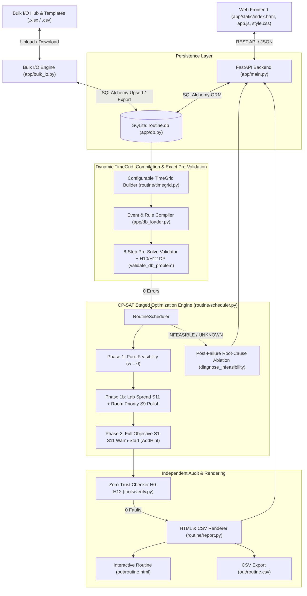

---

## 2. End-to-End System Workflow

Timetable generation executes through a deterministic pipeline orchestrated by [`generate_routine`](app/main.py#L1769-L1927):

1. **Department Schedule & Resource Setup**: Configure working days, period durations, and break boundaries in SQLite (`AppSetting` key `time_grid`, [`get_db_time_grid_config`](app/db.py#L672-L689)), and populate [`Teacher`](app/db.py#L18-L29), [`Room`](app/db.py#L32-L38), and [`Course`](app/db.py#L56-L78) rows manually or via Excel/CSV upload ([`app/bulk_io.py`](app/bulk_io.py)).
2. **Faculty Availability & Course Constraints**: Define teacher unavailability ([`TeacherUnavailable`](app/db.py#L94-L101)) and course/section/group slot + optional room rules ([`CourseSlotRule`](app/db.py#L104-L116)), plus optional course-specific rooms (`Course.allowed_rooms`).
3. **Term Activation & Teacher Assignments**: Only batches toggled `status='on'` are compiled into active scheduling events. Turning any batch `'off'` via [`update_batch_status`](app/main.py#L1401-L1424) deletes its `ScheduledAssignment` records immediately so classrooms, labs, and teachers become free. Assigning `teacher1_id` / `teacher2_id` activates elective (`optional_ii` / `optional_iii`) offerings.
4. **Dynamic Domain Compilation**: [`load_problem_from_db`](app/db_loader.py#L176-L420) builds the configured [`TimeGrid`](app/db_loader.py#L108-L120) and compiles active rows into [`Problem`](routine/models.py#L139-L311), [`Course`](routine/models.py#L45-L84), and [`Event`](routine/models.py#L88-L135) objects via [`_build_events`](app/db_loader.py#L423-L725), resolving Constraint 1, hierarchical Group $\to$ Section $\to$ Course Constraint 3 rules, and per-slot target room bindings (`slot_room_rules`).
5. **Exact Mathematical Pre-Validation**: [`validate_db_problem`](app/db_loader.py#L923-L1220) runs 8 soundness checks—including fixed single-room/slot collision checks, Kuhn bipartite matchings ([`_has_bipartite_matching`](app/db_loader.py#L728-L745)) for `H4` & `H12`, and an exact per-day bitmask + cross-day dynamic programming capacity proof ([`_max_teacher_capacity_under_h4_h10`](app/db_loader.py#L748-L920)).
6. **Incremental Freeze Pinning & Staged CP-SAT Solve**:
   - In **Incremental Mode**, prior placements for selected frozen batches are loaded from `scheduled_assignments` ([`get_saved_placements_map`](app/db.py#L549-L559)) and locked via [`_c_freeze`](routine/scheduler.py#L376-L396). In **Full Generation Mode**, all old `scheduled_assignments` rows are cleared prior to saving.
   - [`solve_routine`](routine/scheduler.py#L881-L966) executes Phase 1 (feasibility), Phase 1b (lab-spread & room-priority warm polish), and Phase 2 (full 11-term objective optimization).
7. **Failure Diagnostics (if unsolvable)**: [`diagnose_infeasibility`](routine/scheduler.py#L1023-L1178) runs controlled relaxation probes ([`_quick_phase1_ok`](routine/scheduler.py#L985-L1020)) to pinpoint the exact frozen batch, overloaded teacher (`H10`/`H12`), Constraint 3 rule, Constraint 1 rule, or `H9` conflict.
8. **Zero-Trust Verification & Output Rendering**: [`verify`](tools/verify.py#L26-L308) independently audits `H0`–`H12`, after which assignments save to `scheduled_assignments` and render to [`out/routine.html`](out/routine.html) and [`out/routine.csv`](out/routine.csv) via [`routine/report.py`](routine/report.py).

---

## 3. Core Features, UI Workspace & User Guide

The web interface (`app/static/index.html`, `app/static/app.js`, `app/static/style.css`) organizes the workflow across **8 primary navigation tabs** plus the global **Bulk I/O** hub:

| Navigation Tab | Purpose & Key Capability |
|:---|:---|
| **`🏠 Home`** | Project landing portal with live active term pills, schedule summary, KPI cards, and 5-step onboarding guide. |
| **`👨‍🏫 Teachers`** | Add/edit/remove teachers, toggle `Active` / `On Leave`, manage Constraint 1 slot unavailability rules, and bulk import/export teachers. |
| **`📚 Courses`** | Canonical 8-term catalog (`1-1`..`4-2`), term `ON`/`OFF` controls, specific room preferences (`allowed_rooms`), Constraint 3 section/group slot + room pinning, and bulk import/export. |
| **`🏫 Rooms & Labs`** | Manage physical theory rooms, departmental software/hardware labs, and non-departmental labs with capacities and categories, plus bulk import/export. |
| **`📋 Assignments`** | Quick course-by-course assignment interface across active running terms enforcing `H8` and lab co-teaching. |
| **`📊 Master Routine`** | Embedded live HTML routine viewer (`Teachers`, `Labs & Rooms`, and `Batches & Sections` master tables + individual sheets) with CSV/PDF download. |
| **`⏰ Time Slots`** | Interactive department schedule customizer (day start, period duration, periods/day, lab length, working days, breaks) with live preview and reset. |
| **`⚡ Generate`** | CP-SAT generation center featuring **Incremental / Freeze Mode** vs **Full Generation Mode**, solve budget selector, validation diagnostics, and verification fault reporting. |
| **`📦 Bulk I/O`** *(header button)* | Unified modal hub for downloading formatted Excel/CSV templates, exporting live database records, and importing datasets with validation. |

---

### 3.1 Home Dashboard & Fresh User Onboarding (`Home`)
Opening [http://localhost:8000](http://localhost:8000/) takes the user to **`🏠 Home`** (`tab-home`), providing an immediate executive overview:
- **Live System Snapshot**: Displays currently running (`ON`) terms, active department hours & period configuration (e.g., `08:00 AM – 05:00 PM`, `9 periods/day · 50 min/class · Sun–Thu`), and CP-SAT optimization readiness.
- **Interactive Resource KPIs**: Clickable stat cards showing active vs total teachers, curriculum courses across running terms, categorized classrooms & labs, and department time grid settings.
- **5-Step Fresh User Onboarding Guide**: Walks new users chronologically from **Step 1 (Time Slots)** $\to$ **Step 2 (Bulk/Manual Teachers, Courses & Rooms)** $\to$ **Step 3 (Activate Terms & Assign Teachers)** $\to$ **Step 4 (Availability & Fixed Slots)** $\to$ **Step 5 (Generate, Verify & Export)**.

---

### 3.2 Flexible Bulk Import / Export Hub & Input Formats (`Bulk I/O`)

Manual one-by-one entry for an entire department (50+ teachers, ~100 courses, 20+ rooms) is tedious. Implemented in [`app/bulk_io.py`](app/bulk_io.py) and exposed via [`app/main.py`](app/main.py#L1678-L1754), the **Bulk I/O** system provides:
- **Downloadable Blank/Sample Templates**: Pre-styled `.xlsx` workbooks (including a dedicated `Instructions (...)` documentation worksheet and required-column color highlights) and clean `.csv` templates.
- **Live Database Export**: Export current live Teachers, Courses (all terms or filtered by batch), Rooms, or an **All-in-One Master Workbook (`.xlsx`)** containing synchronized `Overview & Guide`, `Rooms`, `Teachers`, and `Courses` sheets.
- **Idempotent Upsert Importing**: Uploading matches existing records case-insensitively by key identifier (`short_code` / slug for Teachers, uppercase `course_code` for Courses, uppercase `room_code` for Rooms), updating existing entries or creating new ones without duplicating records. Header normalization ([`_normalize_key`](app/bulk_io.py#L652-L657)) strips `*`, parentheses, slashes, and hyphens so flexible header spelling works seamlessly.
- **Strict Dependency Sequencing in Master Workbook Imports**: [`import_all_in_one_workbook`](app/bulk_io.py#L1037-L1062) always processes sheets in order **`Rooms` $\to$ `Teachers` $\to$ `Courses`**, and automatically runs `_sync_course_assignments` so teacher assignments immediately populate the `assignments` matrix.

#### Input Format Specification for Fresh Users

##### 1. Teachers Format (`Teachers` sheet or `teachers.csv` / `teachers.xlsx`)
Defined in [`TEACHER_COLUMNS`](app/bulk_io.py#L76-L107) and imported via [`import_teachers_data`](app/bulk_io.py#L728-L809):

| Column Header | Req. | Accepted Values / Format | Description & Example |
|:---|:---:|:---|:---|
| `Full Name *` | **Yes** | Non-empty text | Full faculty name, e.g., `Dr. M. M. A. Hashem` |
| `Short Code *` | **Yes** | 2–4 uppercase letters (unique) | Official display code used on routines, e.g., `MMA`, `DD`, `IH` |
| `Department` | No | `CSE`, `ECE`, `EEE`, `ME`, `MATH`, `PHY`, `HUM`, `CHEM` | Defaults to `CSE` |
| `Status` | No | `Active` or `On Leave` | Setting `On Leave` blocks all 45 weekly slots; defaults to `Active` |
| `Max Periods / Day` | No | Integer `1`–`9` | Daily load guideline (soft S4 & hard ceiling `cap * n_days`); defaults to `5` |

##### 2. Courses Format (`Courses` sheet or `courses.csv` / `courses.xlsx`)
Defined in [`COURSE_COLUMNS`](app/bulk_io.py#L109-L176) and imported via [`import_courses_data`](app/bulk_io.py#L812-L974):

| Column Header | Req. | Accepted Values / Format | Description & Example |
|:---|:---:|:---|:---|
| `Course Code *` | **Yes** | Alphanumeric code (spaces stripped) | Unique course code, e.g., `CSE1203`, `CHEM1207`, `CSE3200` |
| `Course Title *` | **Yes** | Non-empty text | Full title, e.g., `Digital Logic Design` |
| `Batch / Term *` | **Yes** | `1-1`, `1-2`, `2-1`, `2-2`, `3-1`, `3-2`, `4-1`, `4-2` | Academic term ID (or matching term name e.g. `1st Year 2nd Term`) |
| `Course Type *` | **Yes** | `Theory` or `Sessional` | Accepts `Theory` or `Sessional` / `Lab` |
| `Credit` | No | `3.0`, `2.0`, `1.5`, `0.75` | `0.75` configures bi-weekly alternating lab blocks; default `3.0` (theory) / `1.5` (sessional) |
| `Required Room Kind` | No | `theory`, `cse_lab`, `hardware_lab_107`, `hardware_lab_108`, `seminar_501`, `chem_lab`, `phy_lab`, `hum_lab`, `ece_lab`, `eee_lab`, `mecha_lab`, `no_room` | Room pool category (`ROOM_KIND_NORMALIZATION` also accepts aliases like `seminar`, `hardware_lab`, `none`) |
| `Allowed Specific Rooms` | No | Comma-separated Room Codes (or blank) | Optional override list, e.g., `CSE-101, CSE-102` or `CSE-103, CSE-104` |
| `Course Category` | No | `Core Course`, `Optional II`, `Optional III` | Electives (`Optional II`/`III`) only schedule when at least 1 teacher is assigned |
| `Periods Per Week` | No | Integer (`2` or `3`) | Theory meetings per week (default `3`); leave blank for Sessional courses |
| `Teacher 1 (Short Code)` | No | Existing Teacher Short Code / Name / ID | Primary lecturer or 1st lab instructor, e.g., `IH` |
| `Teacher 2 (Short Code)` | No | Existing Teacher Short Code / Name / ID | Theory co-teacher or 2nd lab instructor, e.g., `BS` |

##### 3. Classrooms & Labs Format (`Rooms` sheet or `rooms.csv` / `rooms.xlsx`)
Defined in [`ROOM_COLUMNS`](app/bulk_io.py#L178-L209) and imported via [`import_rooms_data`](app/bulk_io.py#L977-L1034):

| Column Header | Req. | Accepted Values / Format | Description & Example |
|:---|:---:|:---|:---|
| `Room Code *` | **Yes** | Unique uppercase identifier | Room ID used internally and in `allowed_rooms`, e.g., `CSE-101`, `CSE-107`, `CHEM-LAB` |
| `Room Name *` | **Yes** | Display title | Readable name shown in printed routines, e.g., `CSE Room 101`, `Chemistry Lab` |
| `Category` | No | `Theory Classrooms`, `Departmental Labs`, `Non-Departmental Labs` | Auto-derived in UI from `kind` (`_categorize_room`) |
| `Room Kind *` | **Yes** | Valid room kind token (same list as Courses) | Determines which courses can use this room (e.g. `theory`, `cse_lab`, `eee_lab`) |
| `Capacity` | No | Positive integer | Seating count (`70` default for theory classrooms, `35` default for labs) |

> **API Endpoints**: `GET /api/templates/{entity}?format=xlsx|csv`, `GET /api/export/{entity}?format=xlsx|csv&batch=...`, and `POST /api/import/{entity}` (`entity` $\in \{\text{teachers}, \text{courses}, \text{rooms}, \text{all}\}$).

---

### 3.3 Department Class Time Slots & Schedule Customizer (`Time Slots`)

Departmental timings are no longer hard-coded. Implemented across [`routine/timegrid.py`](routine/timegrid.py#L210-L355), [`app/db.py`](app/db.py#L672-L714), and [`app/main.py`](app/main.py#L467-L521), administrators can open **`⏰ Time Slots`** to customize:
- **Day Start Time** (default `08:00 AM`), **Class Duration** (`50` min), **Classes per Day** (`9`, `P1`–`P9`), and **Lab Session Length** (`3` contiguous periods).
- **Institutional Working Days**: Toggle any subset of days (`Sunday`–`Thursday` by default).
- **Named Breaks (Academic Block Cutters)**: Add, edit duration, or remove breaks after specific periods (default: `Snack break` 10 min after `P3`, `Lunch & prayer` 80 min after `P6`). Every break partitions the daily timeline into contiguous teaching blocks that 3-period sessional labs cannot cross (`H6`).
- **Live Daily Timeline Preview & Persistence**: Edits trigger [`POST /api/time-grid/preview`](app/main.py#L500-L508) (`compute_time_grid_details`) to preview total teaching hours, break totals, day end time, and which blocks fit 3-period labs before saving to `app_settings` (`POST /api/time-grid`) or restoring institutional defaults via **Reset to Default** (`POST /api/time-grid/reset`).

---

### 3.4 Classrooms & Laboratories Facility Manager (`Rooms & Labs`)
Managed in **`🏫 Rooms & Labs`** and backed by [`/api/rooms`](app/main.py#L1600-L1670), all physical rooms are automatically classified ([`_categorize_room`](app/main.py#L1590-L1597)) into three clean hierarchies:
1. **Theory Classrooms** (`theory`, `seminar_501`): e.g., `CSE-101`, `CSE-102`, `CSE-105`, `CSE-306`, `CSE-401`, `CSE-402`, `CSE-501`, `CSE-502` (capacity `70`).
2. **Departmental Labs**:
   - *Software Labs* (`cse_lab`): `CSE-103`, `CSE-104`, `CSE-201`, `CSE-202`, `CSE-305` (plus dual-use backup `CSE-306` penalized by `S9` overflow).
   - *Hardware Labs*: `CSE-107` (`hardware_lab_107`) & `CSE-108` (`hardware_lab_108`).
3. **Non-Departmental Labs**: `CHEM-LAB` (`chem_lab`), `HUM-LAB` (`hum_lab`), `PHY-LAB` (`phy_lab`), `ECE-104` (`ece_lab`), `EEE-LAB` (`eee_lab`), `MECHA-LAB` (`mecha_lab`).

---

### 3.5 Faculty Management & Manual Slot Flexibility (`Teachers` — Constraint 1 & H12/S11)
- **Teacher Profiles & Daily Ceilings**: Managed in [`Teacher`](app/db.py#L18-L29) with `short_code`, `department`, `status` (`active` or `on_leave`), and `max_periods_per_day` (soft threshold used in `S4` and hard weekly upper bound `max_periods_per_day * n_days`).
- **Constraint 1 (Manual Slot Unavailability)**:
  - **Daily restrictions**: `day = "daily"` (or `"all"` / `"*"`), e.g. `P1,P2,P3` blocks 08:00–10:30 AM across all working days.
  - **Weekly day-specific restrictions**: e.g. Monday `P1,P2,P3` and Tuesday `P7,P8,P9`.
  - **On-Leave toggle**: Setting `status="on_leave"` expands blocked slots to all `grid.n_slots` slots (`0..44`).
  - Rendered with hatched `"Off"` indicators on both the Teachers Master Routine and individual teacher cards ([`routine/report.py#L551-L556`](routine/report.py#L551-L556)).
- **Teacher Daily Lab Workload Cap (`H12` & `S11`)**:
  - **Hard Constraint H12**: No teacher is assigned more than `max_teacher_labs_per_day = 2` lab sessions on the same day.
  - **Soft Constraint S11**: Strongly rewards placing at most `1` lab session per day per teacher whenever mathematically possible (`weight = 120`). Student cohorts remain exempt so multi-lab student days pack legally.

---

### 3.6 Course Room Preferences, Hierarchical Slot + Room Pinning (`Courses` — Constraint 3 / H11)

Two major enhancements give coordinators pinpoint control over classrooms and lab groups:

1. **Course-Level Specific Room Assignment (`Room Assignment Preference`)**:
   - Inside the **Add / Edit Course** modal (`Course.allowed_rooms`), coordinators can switch between:
     - **`🏢 All Category Rooms`**: Uses standard KUET CSE rules (section homerooms for theory; full departmental pool `CSE-103..305` for software labs; designated room for specialized labs).
     - **`🎯 Specific Room(s)`**: Displays multi-select room checkboxes filtered to the selected category (with **`Select All`**, **`Clear All`**, and **`Show All Rooms`** cross-category toggle) so users can restrict any theory or lab course to specific rooms (e.g., `CSE1203` $\to$ `CSE-101, CSE-102` or `CSE1206` $\to$ `CSE-103, CSE-104`).
   - Enforced at highest priority in [`Problem.feasible_rooms`](routine/models.py#L179-L207) and audited by [`tools/verify.py#L55-L58`](tools/verify.py#L55-L58).

2. **Hierarchical Slot Availability & Per-Rule Target Room Pinning (`Manage Course Slot Availability & Fixed Slots`)**:
   - Stored in [`CourseSlotRule`](app/db.py#L104-L116) with `day`, `periods`, `rule_type` (`"allowed"` / `"blocked"`), `section` scope, and optional `room_id`.
   - **Three-Level Scope Targeting**:
     - **Course-Wide**: `All Sections & Groups` (`section = None`).
     - **Section-Specific**: `Section A` or `Section B` — ideal for pinning theory sections to distinct slots and rooms (e.g. `Sec A` Sunday `P1` in `CSE Room 101`; `Sec B` Sunday `P2` in `CSE Room 102`).
     - **Group-Level for 1.5-Credit Labs**: For `sessional` courses (`1.5` cr / `3.0` cr), the Section / Group Scope selector exposes **`Group A1`**, **`Group A2`**, **`Group B1`**, and **`Group B2`**, allowing each group to be pinned to its own block and specific laboratory room (e.g. `CSE1204 Group B1` $\to$ Monday `P7–P9` in `CSE Lab 107`, `CSE1206 Group B2` $\to$ Monday `P7–P9` in `CSE Lab 104`).
   - **Rule Precedence & Automatic Sync Relaxation**:
     - During compilation ([`_apply_course_slot_rules`](app/db_loader.py#L637-L706)), precedence resolves strictly from most specific to broadest: **Group Rule (`A1`/`A2`/`B1`/`B2`) $\to$ Section Rule (`A`/`B`) $\to$ Course-Wide Rule**.
     - In [`_c_sync_group_labs`](routine/scheduler.py#L345-L359), if sibling groups of the same section carry disjoint `allowed_slots` or conflicting `blocked_slots`, `H9` simultaneous-group locking is automatically waived so independent group pins never cause artificial infeasibility.
   - **Paired 0.75-Credit Labs**: Mutually paired courses (e.g. `CHEM1208`, `HUM1108`/`PHY1108`, `CSE3106`/`CSE3120`) automatically intersect `allowed_slots` and union `blocked_slots` ([`app/db_loader.py#L710-L724`](app/db_loader.py#L710-L724)).

---

### 3.7 Dynamic Term Status Control (`ON` vs `OFF`) & Resource Refresh
- Only batches with `Batch.status == "on"` are compiled into solver events by [`load_problem_from_db`](app/db_loader.py#L198-L216).
- **Immediate Resource Refresh on Term Deactivation**: When a term is toggled **`OFF`** via [`PATCH /api/batches/{batch_id}/status`](app/main.py#L1401-L1424), the backend immediately executes `db.query(ScheduledAssignmentModel).filter_by(batch_id=batch_id).delete()` so any rooms, labs, and teacher hours previously occupied by that term are released immediately while preserving syllabus courses and teacher assignments in the catalog for future reactivation.
- **Single-Term Schedule Fresh Fallback**: In the Generate tab ([`renderFreezeBatchSelector`](app/static/app.js#L3176-L3212)), when `activeBatches.length == 1`, that single active term defaults to unchecked (`⚡ Schedule Fresh`) rather than freezing against itself.

---

### 3.8 Course Assignment, Co-Teaching & Batch Scoping (`Assignments` — H8)
- **Theory Co-Teaching**: Assigning `Teacher 1` and `Teacher 2` compiles weekly lectures $k=0,1,\dots$ into:
  - Meeting 1 (`k=0`): `[T1]` individual
  - Meeting 2 (`k=1`): `[T2]` individual
  - Meeting 3 (`k>=2`): `[T1, T2]` joint shared class (`is_shared=True`, displayed `T1/T2`)
- **Lab Co-Teaching**: Every weekly or alternating lab is conducted jointly by `[T1, T2]` (displayed `T1+T2`).
- **H8 Batch-Scoped Theory Limit**: Within any single active batch (`1-1`..`4-2`), a teacher may hold **at most one distinct theory course** across both primary and co-teacher roles (`validate_db_problem`, [`tools/verify.py#L144-L157`](tools/verify.py#L144-L157)). Holding theory courses in *separate* batches is permitted.

---

### 3.9 Master Routine, Concurrent Multi-Group Lab Rendering & Multi-Perspective Views (`Master Routine`)
- Generates synchronized tabs inside [`routine/report.py`](routine/report.py): **Master Routine** (`Teachers`, `Labs & Rooms`, and `Batches & Sections`), **Teachers** filterable individual cards (with hatched `Unavailable / Off Slot` cells and `⚡ Same Course Back-to-Back` badges), and **Termwise Section Sheets**.
- **Concurrent Different-Course Group Lab Stacking**:
  - When different student groups of the same section attend different laboratory courses in separate rooms at the exact same slot (e.g., `B1` in `CSE1204` @ `CSE Lab 107` and `B2` in `CSE1206` @ `CSE Lab 104` on Monday `P7–P9`), [`_section_grid`](routine/report.py#L177-L270) buckets all labs at `(d, p, "lab")` together rather than overwriting by course code, sorting concurrent entries deterministically by `(e["group"], e["code"])` (`A1` before `A2`, `B1` before `B2`).
  - Both the **Section Timetable** and **Batches & Sections Master Routine** render all concurrent lab entries stacked vertically inside the cell with dashed row separators (`.m-cell-lab .m-meta + .m-code`), course codes, 📌 `Fixed` badges, group tags, rooms, and instructor initials.

---

### 3.10 Incremental / Freeze Routine Generation & Diagnostics (`Generate`)
- **Incremental / Freeze Mode**: Selected checked active terms stay 100% locked in `scheduled_assignments` via $x_{e, r^*, s^*} = 1$ while unchecked newly activated terms schedule cleanly around remaining rooms and teacher hours.
- **Full Generation Mode**: Rebuilds all active (`ON`) terms from scratch and clears stale `scheduled_assignments` rows belonging to inactive (`OFF`) terms ([`app/main.py#L1865-L1869`](app/main.py#L1865-L1869)).
- **Pre-Validation & Root-Cause Ablation**: Instant error feedback on mathematically unsolvable configurations plus post-failure diagnostics (`FREEZE_CONFLICT`, `H10`, `H12`, `Constraint 3`, `Constraint 1`, `H9`).

---

### 3.11 Project & Thesis (`CSE 3200` / `CSE 4000`) & Joint Seminar (`CSE 3230`)
- **`CSE 3200` (3-2, 1.5 cr, 1 block/wk)** and **`CSE 4000` (4-1 1.5 cr 1 block/wk; 4-2 3.0 cr 2 distinct-day blocks/wk)**: Section-wide (`group=None`), zero central instructors (`teacher_ids=[]`), virtual room `NO_ROOM` (`room_kind="no_room"`), exempt from physical room conflicts, teacher lab caps (`H10`, `H12`), and the Rooms Master table.
- **`CSE 3230` (Technical Writing and Seminar, 0.75 cr)**: Compiled as a single batch-wide joint event (`section="A/B"`, occupying all `(section, group)` cohorts simultaneously) scheduled exclusively inside `CSE-501` (`room_kind="seminar_501"`), with room demand accounted inside `theory` capacity validation.

---

## 4. Mathematical Formulation & CP-SAT Implementation Logic

The optimization model is constructed inside [`RoutineScheduler`](routine/scheduler.py#L63-L875) over [`TimeGrid`](routine/timegrid.py#L39-L190) and [`Problem`](routine/models.py#L139-L311).

### 4.1 Configurable Time Grid, Contiguous Blocks & Break Boundaries

Implemented in [`routine/timegrid.py`](routine/timegrid.py#L39-L355) with institutional defaults in [`app/db_loader.py#L40-L55`](app/db_loader.py#L40-L55) (customizable via UI/DB):

- **Days ($D$)**: $d \in \{0, \dots, n_{\text{days}}-1\}$ (default `5`: `Sunday`–`Thursday`).
- **Periods ($P$)**: $p \in \{0, \dots, n_{\text{periods}}-1\}$ (default `9`: `P1`–`P9`, `50` minutes each).
- **Flat Slot Index ($S$)**: $n_{\text{slots}} = n_{\text{days}} \cdot n_{\text{periods}}$ (default `45`, indexed `0..44`):
  $$\text{slot}(d, p) = d \cdot n_{\text{periods}} + p, \qquad d = \lfloor s / n_{\text{periods}} \rfloor, \quad p = s \bmod n_{\text{periods}}$$

Default KUET CSE schedule topology:

| Period | Index ($p$) | Time Window | Block Assignment |
|:---|:---:|:---|:---|
| `P1`, `P2`, `P3` | `0, 1, 2` | `08:00–08:50`, `08:50–09:40`, `09:40–10:30` | **Block 1** `[0, 1, 2]` |
| *Snack Break* | — | `10:30–10:40` (10 min break after `P3`) | *Hard block cut* |
| `P4`, `P5`, `P6` | `3, 4, 5` | `10:40–11:30`, `11:30–12:20`, `12:20–13:10` | **Block 2** `[3, 4, 5]` |
| *Lunch & Prayer* | — | `13:10–14:30` (80 min break after `P6`) | *Hard block cut* |
| `P7`, `P8`, `P9` | `6, 7, 8` | `14:30–15:20`, `15:20–16:10`, `16:10–17:00` | **Block 3** `[6, 7, 8]` |

[`TimeGrid._compute_blocks`](routine/timegrid.py#L69-L87) splits period indices at every configured break. Multi-period sessional labs (`lab_periods = 3`) restrict candidate start slots via [`lab_start_slots`](routine/timegrid.py#L123-L135) solely to unbroken intra-block start positions (`{0, 3, 6} + 9d` by default).

---

### 4.2 Domain Pruning, Decision Variables & $O(1)$ Coverage Indexing

Implemented in [`RoutineScheduler._create_variables`](routine/scheduler.py#L115-L197):

1. **Pruned Variable Creation (`x`, `slot_var`)**:
   For each event $e \in E$:
   - Candidate rooms $R_e$ come from [`Problem.feasible_rooms(e)`](routine/models.py#L173-L289), intersected with sectional theory homerooms (when `not ev.allowed_rooms`), and unioned with any explicit room targets in [`ev.slot_room_rules`](routine/scheduler.py#L148-L156).
   - Candidate starts $S_e$ come from [`Problem.feasible_starts(e)`](routine/models.py#L291-L311), pre-filtered for break cuts, Constraint 1 teacher unavailability, and Constraint 3 course/section/group slot rules.
   - Any `(r, s)` pair whose covered slots include a slot mapped in `ev.slot_room_rules` to a different room is excluded immediately before creating variables ([`routine/scheduler.py#L163-L174`](routine/scheduler.py#L163-L174)):
     $$x_{e, r, s} \in \{0, 1\} \iff \text{event } e \text{ starts in room } r \text{ at flat slot } s$$
2. **Start-Slot Channeling Variable**:
   $$S_e \in \{0, \dots, n_{\text{slots}}-1\}, \qquad S_e = \sum_{(r, s)} s \cdot x_{e, r, s}$$
3. **$O(1)$ Coverage Indexes (`cover` & `cover_room`)**:
   - `self.cover[ev.eid][t]` = all literals $x_{e, r, s}$ with $s \le t < s + \text{length}(e)$
   - `self.cover_room[ev.eid][(rid, t)]` = all literals $x_{e, rid, s}$ occupying room `rid` at slot `t`
4. **Derived Boolean Occupancy Indicators**:
   - `self.cohort_busy[ck][t]` $\in \{0, 1\}$ and `self.teacher_busy[tid][t]` $\in \{0, 1\}$.

---

### 4.3 All Hard Constraints & Pins (`H0`–`H12` & `Freeze`)

Every schedule accepted by the system satisfies **all 13 hard constraints (`H0`–`H12`)** plus optional Freeze pins.

#### H0: Exact Placement (Completeness)
- **Formulation**: $\sum_{(r, s)} x_{e, r, s} = 1, \; \forall e \in E$.
- **Code**: `AddExactlyOne(cells.values())` in [`_create_variables`](routine/scheduler.py#L179); audited in [`tools/verify.py#L30-L33`](tools/verify.py#L30-L33).

#### H1: Student Cohort Non-Overlap (Zero Student Clashes)
- **Cohort Expansion** ([`Problem.cohorts_of`](routine/models.py#L162-L171)): Theory/project courses occupy all groups; joint `CSE 3230` (`"A/B"`) occupies every section & group; standalone bi-weekly `0.75`-cr labs (`"G1/G2"`) occupy both groups of the section; weekly/paired labs occupy only their single subgroup.
- **Formulation**: $b^{\text{coh}}_{c, t} = \sum_{e : c \in \text{cohorts}(e)} \sum_{x \in \text{cover}[e][t]} x \in \{0, 1\}$.
- **Code**: [`_c_cohort_conflicts`](routine/scheduler.py#L205-L227).

#### H2: Teacher Non-Overlap (Zero Faculty Clashes)
- **Formulation**: $b^{\text{tch}}_{T, t} = \sum_{e : T \in \text{teachers}(e)} \sum_{x \in \text{cover}[e][t]} x \in \{0, 1\}$.
- **Code**: [`_c_teacher_conflicts`](routine/scheduler.py#L229-L252).

#### H3: Physical Room Non-Overlap (`NO_ROOM` Excluded)
- **Formulation**: $\sum_{e \in E} \sum_{x \in \text{cover\_room}[e][(r, t)]} x \le 1, \; \forall r \in R \setminus \{\text{NO\_ROOM}, \text{""}\}, \; \forall t$.
- **Code**: [`_c_room_conflicts`](routine/scheduler.py#L254-L264).

#### H4: Same Course-Section Distinct-Day Spread & Symmetry Breaking
- **Formulation**: Within each cohort bundle $G_k = (\text{code}, b, \text{sec}, g)$, at most 1 meeting occurs on any day $d$ ($\le 1$), and sibling `meeting_index` slots obey $S_{e_0} < S_{e_1} < \dots < S_{e_{m-1}}$.
- **Code**: [`_c_theory_spread_and_symmetry`](routine/scheduler.py#L266-L294).

#### H5: Room Matching, Custom Specific Rooms, Homeroom Binding & Capacity
- **Resolution Order** ([`Problem.feasible_rooms`](routine/models.py#L173-L289) & [`_create_variables`](routine/scheduler.py#L136-L173)):
  1. **Project/Thesis (`CSE 3200`, `CSE 4000`, `no_room`)**: Always `[NO_ROOM]`.
  2. **Per-Slot Target Room Pinning (`ev.slot_room_rules`)**: Any slot mapped to a target room restricts valid variables at that slot to that exact room (`tools/verify.py#L49-L54`, `#L274-L283`).
  3. **Course Specific Rooms (`ev.allowed_rooms`)**: If specified in the Course Add/Edit modal or Bulk Import (`Allowed Specific Rooms`), takes top precedence over default category/homeroom pools (matching by Room ID or Name with capacity check and lenient fallback).
  4. **Theory Homeroom Binding**: When `not ev.allowed_rooms`, non-lab theory courses bind to each section's homeroom (`DEFAULT_HOME_ROOMS` below, unioned with any `slot_room_rules`):

     | Section Key | Home Room | Section Key | Home Room |
     |:---|:---:|:---|:---:|
     | `1-1\|A`, `1-2\|A` | `CSE-101` | `3-1\|A`, `3-2\|A` | `CSE-401` |
     | `1-1\|B`, `1-2\|B` | `CSE-102` | `3-1\|B`, `3-2\|B` | `CSE-402` |
     | `2-1\|A`, `2-2\|A` | `CSE-105` | `4-1\|A`, `4-2\|A` | `CSE-501` |
     | `2-1\|B`, `2-2\|B` | `CSE-306` | `4-1\|B`, `4-2\|B` | `CSE-502` |

  5. **Specialized Lab & Seminar Bindings**: `CSE3106`/`CSE2104` $\to$ `CSE-107`, `CSE1204` $\to$ `CSE-108`, `CSE3230` $\to$ `CSE-501`, `EEE1208`/`EEE2118` $\to$ `EEE-LAB`, `ME2170` $\to$ `MECHA-LAB`, `ECE2214`/`ECE2208` $\to$ `ECE-104`, `CHEM1208` $\to$ `CHEM-LAB`, `HUM1108` $\to$ `HUM-LAB`, `PHY1108` $\to$ `PHY-LAB`.
  6. **Software Lab Pool** (`cse_lab`, `year1_cse_lab`, `ai_lab`, `network_lab`): `["CSE-103", "CSE-104", "CSE-201", "CSE-202", "CSE-305", "CSE-306"]` (steered softly away from overflow `CSE-306` via `S9`).

#### H6: Single-Day & Break-Free Contiguous Block Containment
- **Rule**: No event may exit the week, span multiple days, or cross any configured break cut (`TimeGrid.lab_start_slots` [`L123-L135`](routine/timegrid.py#L123-L135)). Audited in [`tools/verify.py#L93-L103`](tools/verify.py#L93-L103).

#### H7: Manual Teacher Slot Flexibility & Leave Status (Constraint 1)
- **Rule**: A teacher cannot teach in any slot in $U(T)$, built from daily/weekly `TeacherUnavailable` records plus `status == "on_leave"` ($U(T) = \{0..n_{\text{slots}}-1\}$) ([`app/db_loader.py#L229-L281`](app/db_loader.py#L229-L281)). Enforced via start pruning and `lit == 0` in [`_c_teacher_conflicts`](routine/scheduler.py#L245-L248).

#### H8: One Theory Course per Batch per Teacher
- **Rule**: Within any single active batch $b$, each teacher may teach at most **1 distinct theory course** across primary & co-teacher assignments ([`validate_db_problem`](app/db_loader.py#L992-L1007), [`tools/verify.py#L144-L157`](tools/verify.py#L144-L157)).

#### H9: Conditional Lab Group Sync & Paired 0.75-Credit Lab Sync
1. **Conditional Group Lab Sync** ([`_c_sync_group_labs`](routine/scheduler.py#L296-L363)): Locks $S_{e_1} = S_{e_2} = \dots$ when `sync_group_labs=True` **only if**:
   - **Room Supply Sufficiency**: Both `len(feasible_rooms(ev)) >= len(evs)` and `room_supply[kind] >= len(evs)`.
   - **Disjoint Group Teachers**: No teacher is shared across groups in the bundle.
   - **Compatible Group Slot Constraints**: Sibling groups do not hold disjoint fixed `allowed_slots` or mutually conflicting `blocked_slots` (e.g. `Group B1` fixed to Sunday vs `Group B2` fixed to Monday waives hard sync automatically).
2. **Paired 0.75-Credit Sync** ([`_c_sync_paired_labs`](routine/scheduler.py#L365-L374)): Links mutually paired `0.75`-cr events (`G1` $\leftrightarrow$ `G2`) unconditionally to the exact same block start ($S_{e_A} = S_{e_B}$).

#### H10: Prohibition of Teacher Consecutive Different-Course Classes (Constraint 2 Hard Rule)
- **Rule**: A teacher must not teach consecutive periods belonging to *different* courses on the same day (excluding roomless `CSE 3200`/`CSE 4000`), with two targeted institutional exemptions:
  - **Adjacent Pairs**: Within blocks `(0,1), (1,2), (3,4), (4,5), (6,7), (7,8)` plus `(2,3)` across the 10-minute morning Snack Break (`(5,6)` Lunch Break included only if `teacher_consecutive_include_lunch=True`).
  - **Cross-Snack Break Lab–Theory Harmony & Explicit User Pins** ([`routine/scheduler.py#L466-L475`](routine/scheduler.py#L466-L475) & [`tools/verify.py#L239-L248`](tools/verify.py#L239-L248)): Across Snack Break (`(2, 3)` / `P3`$\to$`P4`), a transition between a **3-period lab session in Block 1 and a theory lecture in Block 2** (or vice versa, `is_lab1 != is_lab2`) is permitted, and any pair where **both events carry explicit Constraint 3 fixed `allowed_slots`** overrides `H10` so user-pinned non-departmental courses never deadlock.
- **Implementation**:
  1. **Positive-Literal Cliques** ([`L449-L475`](routine/scheduler.py#L449-L475)): Direct pairwise/clique `AddAtMostOne` constraints without cancellation slack.
  2. **Implied Block-Capacity Cut** ([`L477-L509`](routine/scheduler.py#L477-L509)): Bounds theory periods plus `(len(blk) - 1) * lab_starts` inside any 3-period block to $\le |B| - 1 = 2$ whenever no single theory course has $\ge 3$ distinct cohorts landing there.

#### H11: Hierarchical Course Slot Availability, Fixed Slots & Target Rooms (Constraint 3)
- **Resolution & Rule Merging** ([`_apply_course_slot_rules`](app/db_loader.py#L637-L724)):
  1. Computes group key (`"A1"`, `"A2"`, `"B1"`, `"B2"`) for group labs (`G1`/`G2` $\to$ `Sec1`/`Sec2`).
  2. `ev.blocked_slots` = union of course-wide, section, and group blocked slots.
  3. `effective_allowed` = intersection cascading **`Group Allowed`** $\to$ **`Section Allowed`** $\to$ **`Course Allowed`**. If a theory course defines $k \le \text{periods\_per\_week}$ allowed slots, each `meeting_index` maps 1-to-1 to a distinct chosen allowed slot so meetings don't collide on one slot.
  4. `ev.slot_room_rules` merges course, section, and group `slot -> room_id` overrides cleanly.
- **Enforcement**: Filtered directly out of variable domains in `Problem.feasible_starts` and `_create_variables`, and verified exhaustively in [`tools/verify.py#L253-L283`](tools/verify.py#L253-L283).

#### H12: Teacher Maximum Daily Lab Session Limit (`max_teacher_labs_per_day = 2`)
- **Formulation**: For any teacher $T$ with $> 2$ weekly non-project labs and each day $d$, $\sum_{e \in L(T), s \in \text{Day}(d)} x_{e, r, s} \le 2$.
- **Scope**: Applies **strictly to teachers**, **never student cohorts**, excluding `CSE 3200`/`4000`, with teacher IDs deduplicated (`dict.fromkeys`). Enforced in [`_c_teacher_max_labs_per_day`](routine/scheduler.py#L511-L547), pre-checked via Kuhn bipartite matching + exact DP in [`validate_db_problem`](app/db_loader.py#L1145-L1201), and audited in [`tools/verify.py#L285-L306`](tools/verify.py#L285-L306).

#### Incremental / Freeze Pinning Constraint
- **Formulation**: $x_{e, r^*, s^*} = 1, \; \forall e \in E_{\text{frozen}}$ ([`_c_freeze`](routine/scheduler.py#L376-L396)). Falls back to `("NO_ROOM", s^*)` if mapped, or raises `FREEZE_CONFLICT` (`ValueError`) if subsequent rule edits invalidated $(r^*, s^*)$.

---

### 4.4 Academic & Domain Event Compilation Rules

[`load_problem_from_db`](app/db_loader.py#L176-L420) and [`_build_events`](app/db_loader.py#L423-L725) compile curriculum records uniformly:

| Rule / Course Pattern | Compilation Behavior | Code Location |
|:---|:---|:---|
| **Elective Gating (`optional_ii`, `optional_iii`)** | Omitted unless `teacher1_id`, `teacher2_id`, or `Assignment` rows exist for that elective. | [`app/db_loader.py#L321-L323`](app/db_loader.py#L321-L323) |
| **Theory Co-Teaching (`T1`, `T2`)** | Across `periods_per_week`: $k=0 \to [T_1]$, $k=1 \to [T_2]$, $k \ge 2 \to [T_1, T_2]$ (`is_shared=True`). | [`app/db_loader.py#L502-L541`](app/db_loader.py#L502-L541) |
| **Weekly Labs (`1.5` or `3.0` cr)** | One event per `(section, group, meeting_index)` of length `grid.lab_periods` (`3`), co-taught by `[T1, T2]`. | [`app/db_loader.py#L611-L635`](app/db_loader.py#L611-L635) |
| **Paired Bi-Weekly Labs (`0.75` cr + partner)** | First partner creates `group="G1"`, second creates `group="G2"`, cross-linked via `paired_event_id`. | [`app/db_loader.py#L554-L593`](app/db_loader.py#L554-L593) |
| **Standalone Bi-Weekly Labs (`0.75` cr)** | Single `group="G1/G2"` event per section (`CHEM1208`, `ME2170`, `ECE2214`, `EEE2118`, etc.) occupying both groups. | [`app/db_loader.py#L594-L610`](app/db_loader.py#L594-L610) |
| **`CSE 3230` (Seminar)** | Single joint batch event `section="A/B"`, `group=None`, `room_kind="seminar_501"` (`CSE-501`). | [`app/db_loader.py#L460-L490`](app/db_loader.py#L460-L490) |
| **`CSE 3200` / `CSE 4000` (Project/Thesis)** | Section-wide `group=None`, `teacher_ids=[]`, `room_kind="no_room"`; 1 block/wk in `3-2` & `4-1`, 2 blocks/wk in `4-2`. | [`app/db_loader.py#L437-L458`](app/db_loader.py#L437-L458) |

---

### 4.5 All Soft Constraints (`S1`–`S11`) & Objective Function

Implemented in [`RoutineScheduler._objective`](routine/scheduler.py#L580-L838) with default weights in [`app/db_loader.py#L81-L93`](app/db_loader.py#L81-L93). Zero-weight terms are skipped completely via [`_wants`](routine/scheduler.py#L572-L578):

$$\min Z = \sum_{k \in \{1..9, 11\}} w_k \cdot \text{Penalty}_k \;-\; w_{10} \cdot \text{SameCourseConsecutive}$$

| ID | Key (`options["weights"]`) | Default Weight | Target | Optimization Intent | Code Lines |
|:---:|:---|:---:|:---|:---|:---|
| **S1** | `cohort_gap` | `8` | Students | Minimizes free idle periods between a cohort's first and last class each day. | [`L584-L590`](routine/scheduler.py#L584-L590) |
| **S2** | `teacher_gap` | `4` | Teachers | Minimizes idle waiting gaps on a teacher's daily schedule. | [`L592-L598`](routine/scheduler.py#L592-L598) |
| **S3** | `last_period` | `2` | Students | Penalizes booking cohorts in the final period (`P9`, `16:10–17:00`). | [`L600-L606`](routine/scheduler.py#L600-L606) |
| **S4** | `teacher_daily_overload` | `6` | Teachers | Penalizes daily teaching periods above `teacher.max_periods_per_day`. | [`L608-L617`](routine/scheduler.py#L608-L617) |
| **S5** | `consecutive_overrun` | `5` | Students | Penalizes > `max_consecutive_periods` (`3`) continuous classes inside a block window. | [`L619-L631`](routine/scheduler.py#L619-L631) |
| **S6** | `room_churn` | `4` | Sections | Penalizes extra distinct theory rooms used by a section beyond 1 room/week. | [`L633-L656`](routine/scheduler.py#L633-L656) |
| **S7** | `theory_slot_priority` | `2` | Theory | Steers lectures to prime mid-morning slots ($P4 > P5 > P6 > P3 > P2 > P1 > P7 > P8 > P9$). | [`L658-L670`](routine/scheduler.py#L658-L670) |
| **S8** | `block_gap` | `10` | Students | Penalizes U-shaped gaps inside Block 1 (`P1&P3` busy, `P2` free) & Block 2 (`P4&P6` busy, `P5` free). | [`L672-L685`](routine/scheduler.py#L672-L685) |
| **S9** | `lab_room_priority` | `2` | Labs | Ranks `CSE-103/104/201/202/305` affinity (`CSE3218`, `42xx`, `41xx`) and penalizes overflow `CSE-306` (`cost 1000`). | [`L687-L732`](routine/scheduler.py#L687-L732) |
| **S10** | `same_course_consecutive` | `-30` (bonus) | Teachers | Maximizes back-to-back Section A & B classes of the same course (**Constraint 2**). | [`L734-L790`](routine/scheduler.py#L734-L790) |
| **S11** | `teacher_extra_lab_day` | `120` | Teachers | Strongly favors $\le 1$ lab session/day per teacher (`2`/day permitted only when necessary). | [`L792-L825`](routine/scheduler.py#L792-L825) |

---

### 4.6 Three-Stage Warm-Start Solving Pipeline

Implemented in [`solve_routine`](routine/scheduler.py#L881-L966) (default `180s`, `workers=8`):

```
[Phase 1: Feasibility]  ──► [Phase 1b: Lab-Spread & Room Pre-Polish] ──► [Phase 2: Full Optimality]
  w = 0 for all S1-S11        w_S11 = 100, w_S9 = max(1, saved_S9)         All S1-S11 weights active
  budget = max(10s, 0.25B)    Triggered if S11 or S9 active & rem > 15s    budget = max(10s, rem)
  Returns `first`             budget = min(12s, 0.25 * rem); AddHint(first) AddHint(warm_sol) -> best
```

---

### 4.7 Exact Pre-Solve Validator & Root-Cause Ablation Engine

#### 8-Step Mathematical Pre-Solve Validator ([`validate_db_problem`](app/db_loader.py#L923-L1220))
1. **Structural Completeness (`L944-L990`)**: Room capacity/kind check, teacher existence, `on_leave` detection, non-empty `feasible_starts`.
2. **H8 Theory-per-Batch Limit (`L992-L1007`)**: Rejects teachers assigned $> 1$ distinct theory course in the same batch.
3. **Paired 0.75-cr Teacher Disjointness (`L1009-L1025`)**: Rejects paired simultaneous labs sharing a teacher.
4. **H4 Distinct-Day Kuhn Matching (`L1027-L1049`)**: Proves whether weekly meetings can scatter onto distinct days via [`_has_bipartite_matching`](app/db_loader.py#L728-L745).
5. **Fixed Single-Room Single-Slot Collision Check (`L1051-L1073`)**: Flags hard `H3` collisions upfront when two fixed events pin to the same single room and time.
6. **Room Supply vs Demand (`L1075-L1098`)**: Checks period-slot utilization per `room_kind` (folding `seminar_501` demand into `theory`, excluding `NO_ROOM`).
7. **Cohort Weekly Load (`L1100-L1112`)**: Audits total cohort periods vs `grid.n_slots`.
8. **H12 Bipartite Check + Exact H4/H10/H12/Availability Capacity DP (`L1114-L1218`)**: Combines per-day bitmask reachability (`_max_teacher_capacity_under_h4_h10`, [`L748-L920`](app/db_loader.py#L748-L920)) across days via `dp[used_labs]` to compute a provably sound weekly upper bound `exact_cap`.

#### Post-Failure Root-Cause Ablation ([`diagnose_infeasibility`](routine/scheduler.py#L1023-L1178))
Probes `freeze=None`, per-teacher `H10`/`H12` subproblems, system-wide `skip_h10`, `skip_h12`, cleared Constraint 3, cleared Constraint 1, and relaxed `H9` to identify the exact culprit automatically.

---

### 4.8 Independent Zero-Trust Verification Auditor

Implemented in [`tools/verify.py`](tools/verify.py#L26-L308) independently of CP-SAT internals, validating **all 13 constraints (`H0`–`H12`)**:
- `H0` placement completeness (`L30-L33`)
- `H5` `slot_room_rules`, custom `allowed_rooms`, specialized labs, theory/software pools, capacity (`L49-L91`)
- `H6` week bounds, single day, and break-free lab blocks (`L93-L103`)
- `H1`/`H2`/`H3`/`H7` cohort/teacher/room non-overlap and teacher unavailability (`L105-L133`)
- `H4` distinct days (`L135-L142`)
- `H8` one theory course per batch per teacher (`L144-L157`)
- `H9` conditional syncable group labs (`L159-L206`)
- `H10` consecutive different-course prohibition including `(2,3)` lab-theory snack-break harmony and fixed-slot exemption (`L208-L251`)
- `H11` course blocked/allowed slot and specific target `slot_room_rules` compliance (`L253-L283`)
- `H12` teacher daily lab ceiling (`L285-L306`)

---

## 5. Database Schema & REST API Reference

### SQLite ORM Schema (`app/db.py`)

| Table (`Class`) | Purpose | Key Columns & Notable Extensions | Line Ref |
|:---|:---|:---|:---|
| `teachers` ([`Teacher`](app/db.py#L18-L29)) | Faculty profiles | `id`, `full_name`, `short_code`, `department`, `status`, `max_periods_per_day` | [`L18-L29`](app/db.py#L18-L29) |
| `rooms` ([`Room`](app/db.py#L32-L38)) | Classrooms & labs | `id`, `name`, `kind`, `capacity` | [`L32-L38`](app/db.py#L32-L38) |
| `batches` ([`Batch`](app/db.py#L41-L53)) | Academic terms (`1-1`..`4-2`) | `id`, `name`, `sections`, `groups`, `section_size`, `group_size`, `status` (`on`/`off`) | [`L41-L53`](app/db.py#L41-L53) |
| `courses` ([`Course`](app/db.py#L56-L78)) | Syllabus courses | `id`, `title`, `batch_id`, `kind`, `room_kind`, `credit`, `category`, **`allowed_rooms`**, `paired_course_id`, `teacher1_id`, `teacher2_id` | [`L56-L78`](app/db.py#L56-L78) |
| `assignments` ([`Assignment`](app/db.py#L81-L91)) | Instructor links | `id`, `course_id`, `section`, `group`, `teacher_id` | [`L81-L91`](app/db.py#L81-L91) |
| `teacher_unavailable` ([`TeacherUnavailable`](app/db.py#L94-L101)) | Constraint 1 rules | `id`, `teacher_id`, `day`, `periods` | [`L94-L101`](app/db.py#L94-L101) |
| `course_slot_rules` ([`CourseSlotRule`](app/db.py#L104-L116)) | Constraint 3 rules | `id`, `course_id`, `day`, `periods`, `rule_type`, `section` (`A`/`B`/`A1`/`A2`/`B1`/`B2`), **`room_id`**, `note` | [`L104-L116`](app/db.py#L104-L116) |
| `scheduled_assignments` ([`ScheduledAssignment`](app/db.py#L119-L129)) | Saved / frozen schedule | `id`, `batch_id`, `course_code`, `section`, `group`, `meeting_index`, `room_id`, `start_slot` | [`L119-L129`](app/db.py#L119-L129) |
| `app_settings` ([`AppSetting`](app/db.py#L132-L136)) | Persistent config JSON | `key` (e.g. `"time_grid"`), `value` | [`L132-L136`](app/db.py#L132-L136) |

### Core FastAPI Endpoints (`app/main.py`)

- **Time Grid**: `GET /api/time-grid`, `POST /api/time-grid`, `POST /api/time-grid/preview`, `POST /api/time-grid/reset`
- **Teachers & Availability**: `GET/POST /api/teachers`, `PUT/DELETE /api/teachers/{id}`, `PATCH /api/teachers/{id}/status`, `GET/PUT/DELETE /api/teachers/{id}/availability`, `POST/DELETE /api/teachers/{id}/availability/rule`
- **Courses & Slot/Room Rules**: `GET/POST /api/courses`, `PUT/DELETE /api/courses/{id}`, `POST /api/courses/{id}/assign-teachers`, `GET/PUT/DELETE /api/courses/{id}/availability`, `POST/DELETE /api/courses/{id}/availability/rule`
- **Rooms & Labs**: `GET/POST /api/rooms`, `PUT/DELETE /api/rooms/{id}`
- **Batches & Assignments**: `GET /api/batches`, `PATCH /api/batches/{batch_id}/status`, `GET/POST /api/assignments`, `POST /api/assignments/save-slot`, `DELETE /api/assignments/{id}`
- **Bulk Import / Export**: `GET /api/templates/{entity}`, `GET /api/export/{entity}`, `POST /api/import/{entity}`
- **Solver & Routine Artifacts**: `GET /api/routine/scheduled-batches`, `POST /api/generate-routine`, `GET /api/routine/latest`, `GET /api/routine/download/csv`, `GET /api/routine/download/html`

---

## 6. Visual Walkthrough & Feature Verification

Below are live screenshots captured from the production web application and generated timetables demonstrating all core and newly added capabilities.

---

### Screenshot 1: Home Dashboard & Fresh User Guide
*Opening interface showing the live system snapshot (active terms, department hours, optimization readiness), resource KPIs, and the 5-step onboarding guide.*

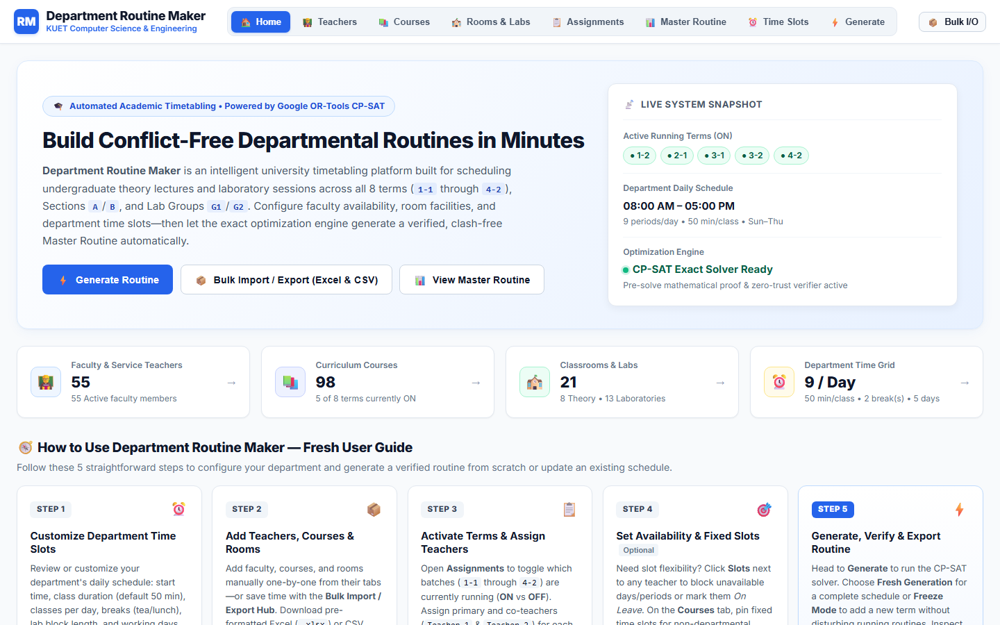

---

### Screenshot 2: Bulk Data Import & Export Hub
*Unified modal providing pre-formatted Master Workbook (`.xlsx`) and entity templates (`.xlsx`/`.csv`), live data export, and multi-sheet validation.*

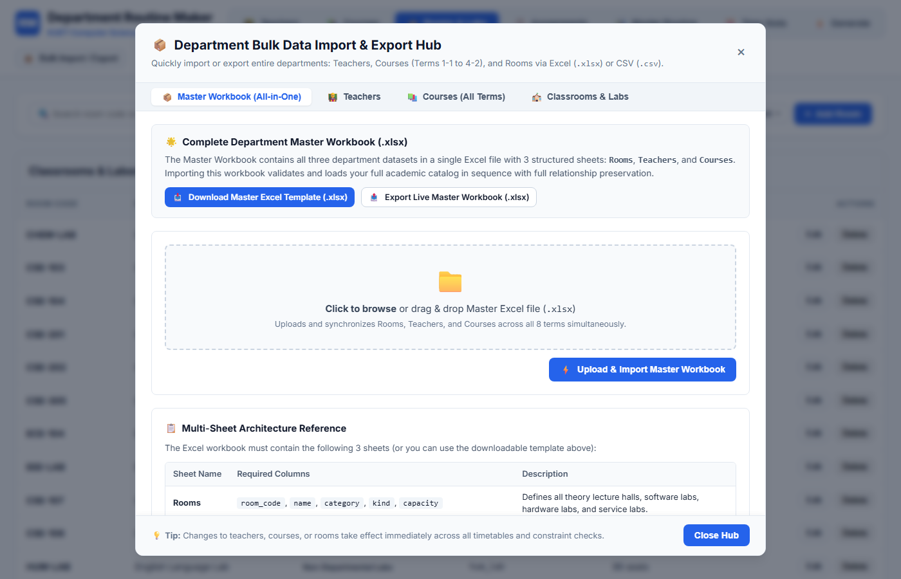

---

### Screenshot 3: Classrooms & Laboratories Management (`Rooms & Labs`)
*Structured table displaying theory lecture halls, departmental software/hardware labs, non-departmental labs, room kinds, and seating capacities.*

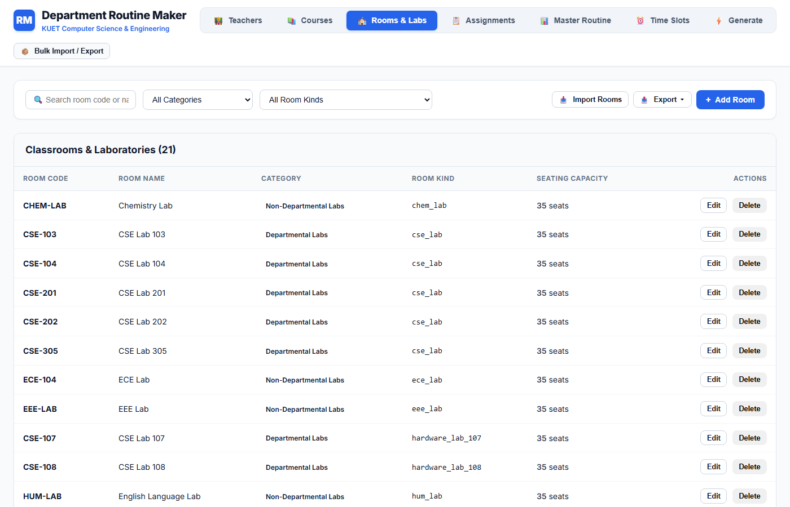

---

### Screenshot 4: Department Class Time Slots & Live Schedule Preview
*Interactive customizer for start time, class duration, periods per day, working days, and break dividers with real-time contiguous lab block verification.*

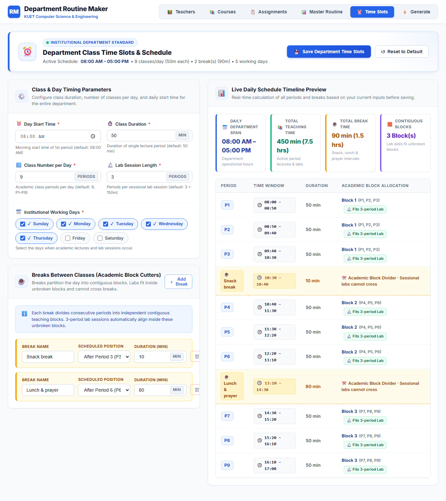

---

### Screenshot 5: Course-Specific Room Assignment (`Specific Room(s)` Selector)
*Course editor allowing selection between default category rooms (`All Category Rooms`) and explicit multi-room pinning (`Specific Room(s)` for both theory classrooms and departmental labs).*

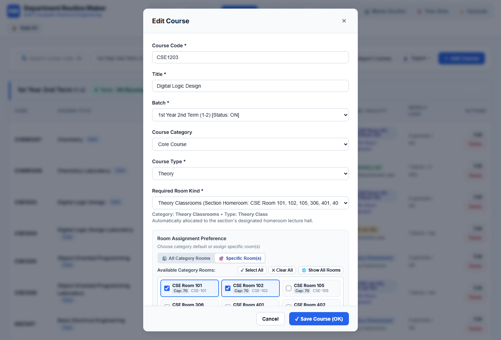

---

### Screenshot 6: Section-Level Slot & Target Room Pinning (`Courses` Constraint 3)
*Decorated rule builder pinning `Section A` and `Section B` of a theory course to distinct time slots and target rooms inside the Course Availability modal.*

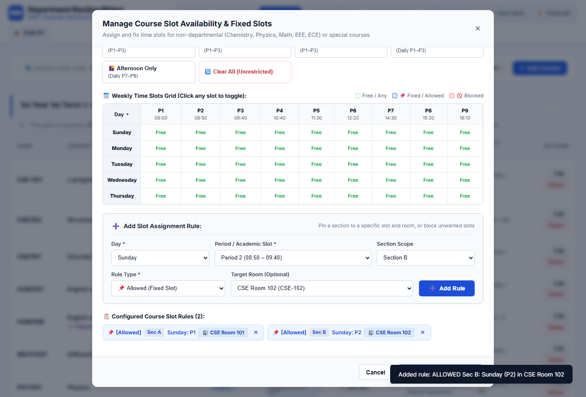

---

### Screenshot 7: Group-Level Slot & Room Pinning for 1.5-Credit Labs (`A1`, `A2`, `B1`, `B2`)
*Rule builder scoped to individual laboratory student groups (`Group A1`, `Group A2`, `Group B1`, `Group B2`), pinning each group to its own block and lab room while auto-waiving H9 group sync.*

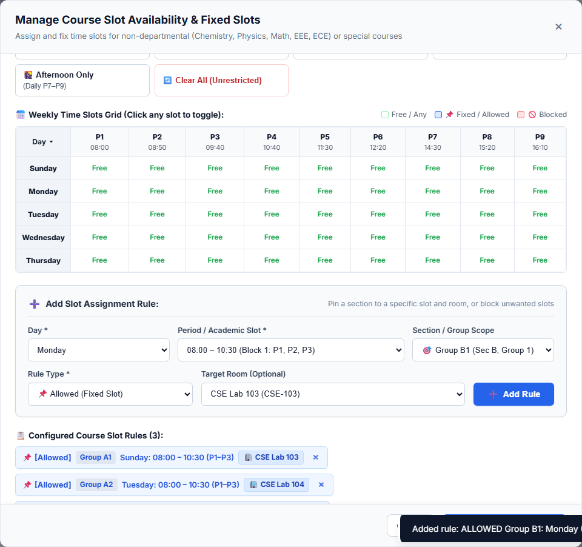

---

### Screenshot 8: Incremental / Freeze Generation & Single-Term Fallback
*Generation control panel showing active running terms, Freeze Mode controls, single-term auto-fresh selection (`Schedule Fresh`), and zero-fault verification confirmation.*

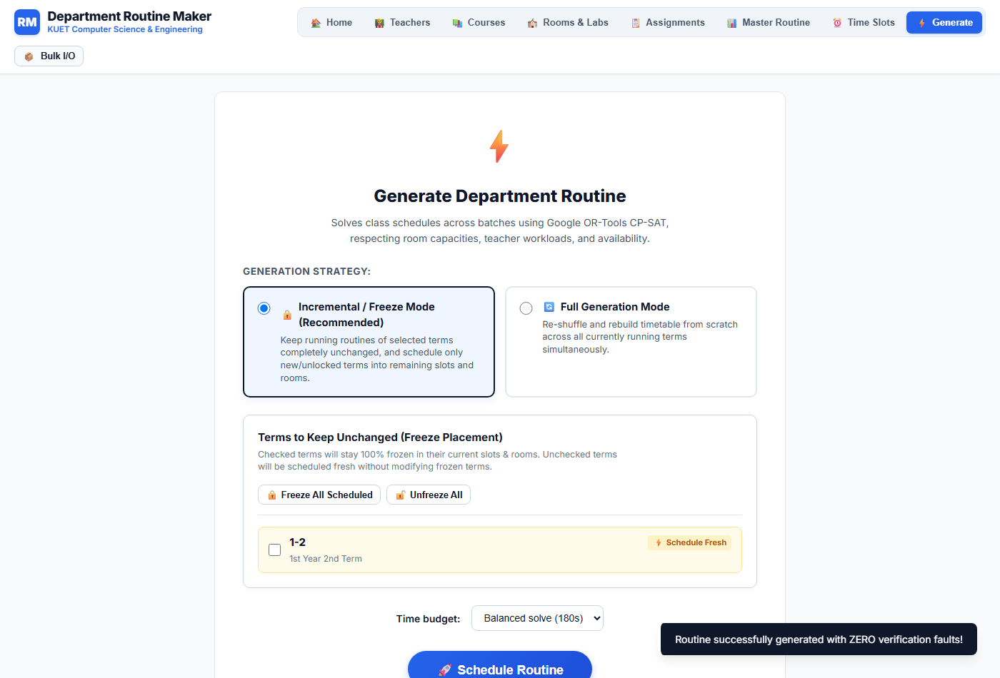

---

### Screenshot 9: Concurrent Multi-Group Different-Course Lab Cell Rendering
*Term `1-2` Section B timetable displaying both `CSE1204 (B1)` in `CSE Lab 107` and `CSE1206 (B2)` in `CSE Lab 104` simultaneously in Monday `P7–P9` with clean stacked formatting and `Fixed` badges.*

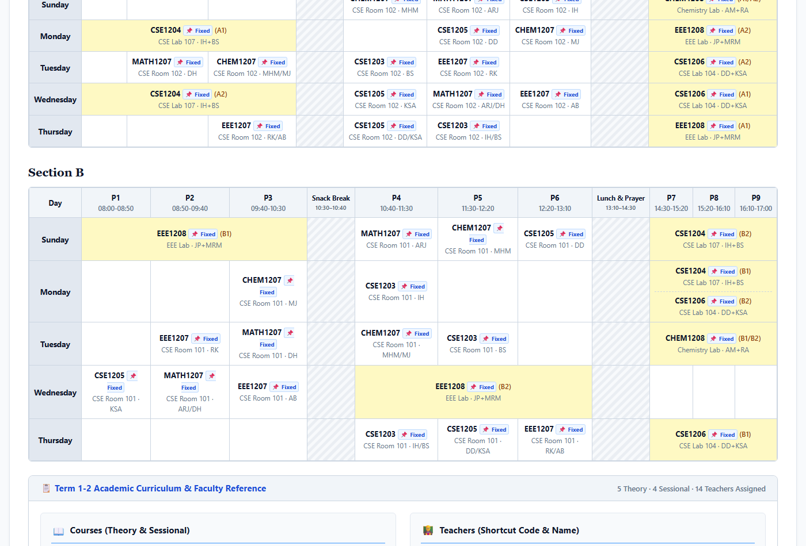

---

### Screenshot 10: Batches & Sections Master Routine with Concurrent Multi-Lab Cell
*Complete Batches Master Routine plotting all active student sections, clearly stacking concurrent group lab sessions (`CSE1204 (B1)` above `CSE1206 (B2)`) separated by dashed dividers.*

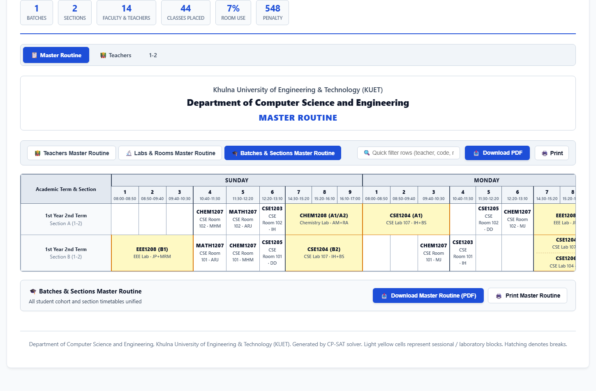

---

### Screenshot 11: Canonical Term Curriculum & Assignments Workspace
*Canonical 8-term curriculum ordering (`1-1` to `4-2`) with dynamic `ON`/`OFF` controls and rapid co-teaching assignments.*

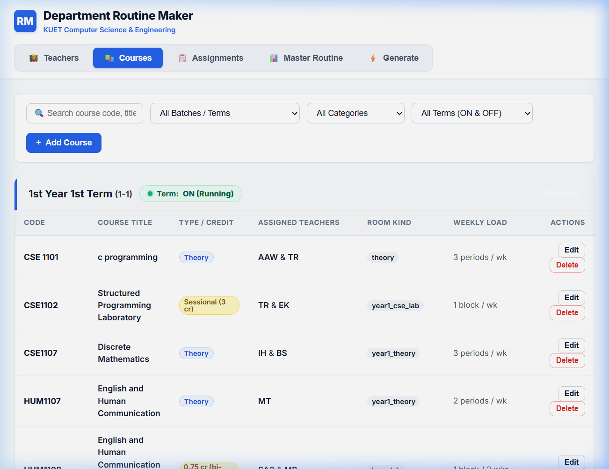


---

### Screenshot 12: Labs & Rooms Master Routine & Individual Teacher Filtering
*Facility utilization matrix and individual faculty schedule card with Constraint 1 `Unavailable` markers and Constraint 2 `Same Course` indicators.*


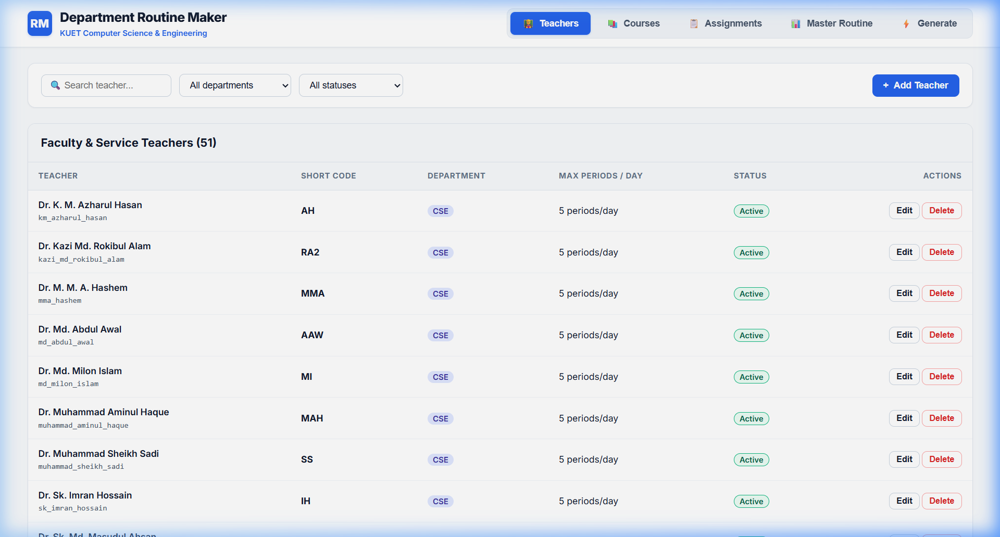

---

## 7. Operational Scenario: Preserving Running Routines

### Practical Scenario: Advancing 4th Year to Term `4-2`
Suppose terms `1-1`, `2-1`, `2-2`, and `3-2` are actively ongoing. Term `4-1` finishes, and term `4-2` is ready to begin. The department must create a timetable for `4-2` **without moving any classes** of the ongoing batches.

#### Step-by-Step Procedure:
1. **Deactivate Completed Term & Activate New Term (`Courses` tab)**:
   - Click `4-1`'s status badge to toggle it **`⚪ Term: OFF`**. `PATCH /api/batches/4-1/status` immediately removes `4-1`'s stale `scheduled_assignments` rows so all teachers and classrooms used by `4-1` become free immediately, while keeping `4-1` syllabus data preserved.
   - Click `4-2`'s status badge to toggle it **`🟢 Term: ON`**.
2. **Assign Teachers & Specific Rooms (`Assignments` / `Courses` tabs)**:
   - Assign faculty to `4-2` core courses and chosen `optional_ii` / `optional_iii` electives (electives without teachers are automatically skipped).
   - Optionally configure custom **Specific Room(s)** or pin external course slots/rooms via **Slots**.
3. **Open `⚡ Generate` Tab**:
   - **Generation Strategy** defaults to **`🔒 Incremental / Freeze Mode (Recommended)`**.
   - Ongoing terms (`1-1`, `2-1`, `2-2`, `3-2`) with existing schedules are automatically **CHECKED** (`🔒 Keep Unchanged`), while `4-2` is **UNCHECKED** (`⚡ Schedule Fresh`).
4. **Click "Schedule Routine"**:
   - Ongoing classes remain locked via $x_{e, r^*, s^*} = 1$; the 3-stage CP-SAT solver schedules `4-2` cleanly into remaining slots and labs with **`0` hard verification faults**.

---

## 8. Constraint Quick-Reference Matrix & Summary

| Code | Constraint Name | Type | Enforcement Mechanism | Primary File & Location |
|:---:|:---|:---:|:---|:---|
| **H0** | Exact Event Placement | Hard | `AddExactlyOne(cells.values())` | [`routine/scheduler.py#L179`](routine/scheduler.py#L179) |
| **H1** | Student Cohort Non-Overlap | Hard | `cbusy == sum(cover)` (`BoolVar <= 1`) | [`routine/scheduler.py#L205-L227`](routine/scheduler.py#L205-L227) |
| **H2** | Teacher Non-Overlap | Hard | `tbusy == sum(cover)` (`BoolVar <= 1`) | [`routine/scheduler.py#L229-L252`](routine/scheduler.py#L229-L252) |
| **H3** | Physical Room Non-Overlap (`NO_ROOM` exempt) | Hard | `AddAtMostOne(cover_room)` | [`routine/scheduler.py#L254-L264`](routine/scheduler.py#L254-L264) |
| **H4** | Course-Section Distinct-Day Spread + Symmetry | Hard | `sum_day <= 1` & `slot_var[a] < slot_var[b]` | [`routine/scheduler.py#L266-L294`](routine/scheduler.py#L266-L294) |
| **H5** | Room Kind, Custom `allowed_rooms`, `slot_room_rules`, Homerooms | Hard | `feasible_rooms` + variable room filtering | [`routine/models.py#L173-L289`](routine/models.py#L173-L289) |
| **H6** | Single-Day & Break-Free Block Containment | Hard | Start pruning (`lab_start_slots`) | [`routine/timegrid.py#L123-L135`](routine/timegrid.py#L123-L135) |
| **H7** | Teacher Slot Flexibility & On-Leave (Constraint 1) | Hard | Start domain pruning + `lit == 0` in `unavailable` | [`routine/scheduler.py#L245-L248`](routine/scheduler.py#L245-L248) |
| **H8** | Max 1 Theory Course per Batch per Teacher | Hard | Admission check (T1 & T2) + verifier | [`app/db_loader.py#L992-L1007`](app/db_loader.py#L992-L1007) |
| **H9** | Conditional Group Lab Sync & Paired 0.75-cr Sync | Hard | `slot_var[a] == slot_var[b]` (supply, teacher & group-slot guarded) | [`routine/scheduler.py#L296-L374`](routine/scheduler.py#L296-L374) |
| **H10** | Teacher No Consecutive Diff-Course (Constraint 2) | Hard | Positive cliques + `(2,3)` lab-theory / fixed override + block cut | [`routine/scheduler.py#L398-L509`](routine/scheduler.py#L398-L509) |
| **H11** | Hierarchical Group/Sec/Course Slots & Target Rooms (Constraint 3) | Hard | Group $\to$ Sec $\to$ Course cascade + `slot_room_rules` | [`app/db_loader.py#L637-L724`](app/db_loader.py#L637-L724) |
| **H12** | Teacher Max 2 Labs/Day (Not Students) | Hard | `sum(day_lab_starts) <= max_teacher_labs_per_day` | [`routine/scheduler.py#L511-L547`](routine/scheduler.py#L511-L547) |
| **Pin** | Incremental / Freeze Mode Locks | Hard | `cells[key] == 1` | [`routine/scheduler.py#L376-L396`](routine/scheduler.py#L376-L396) |
| **S1–S11** | Weighted Quality Objective (`cohort_gap`..`teacher_extra_lab_day`) | Soft | Lazy-built linear terms & bonuses (`_wants`) | [`routine/scheduler.py#L572-L838`](routine/scheduler.py#L572-L838) |

The **KUET CSE Routine Maker** unites exact CP-SAT constraint satisfaction, flexible Excel/CSV onboarding, customizable institutional time grids, granular room and lab-group control, pre-solve dynamic programming feasibility proofs, and zero-trust verification into an end-to-end production departmental scheduling suite.
