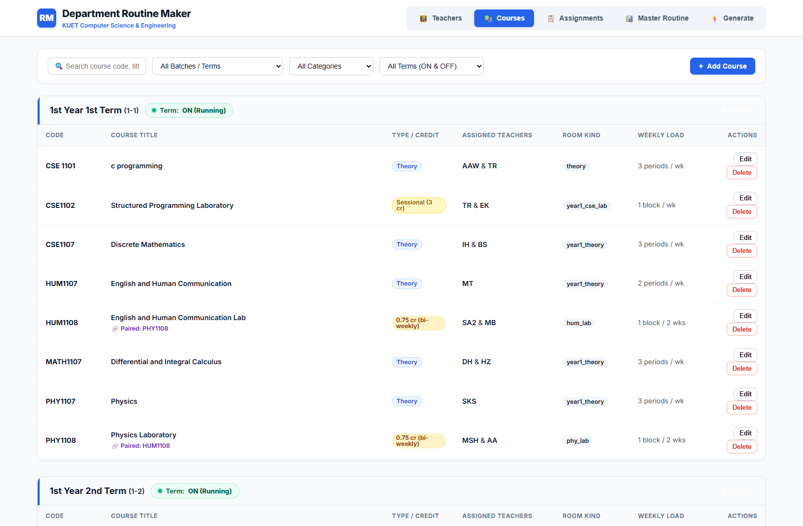
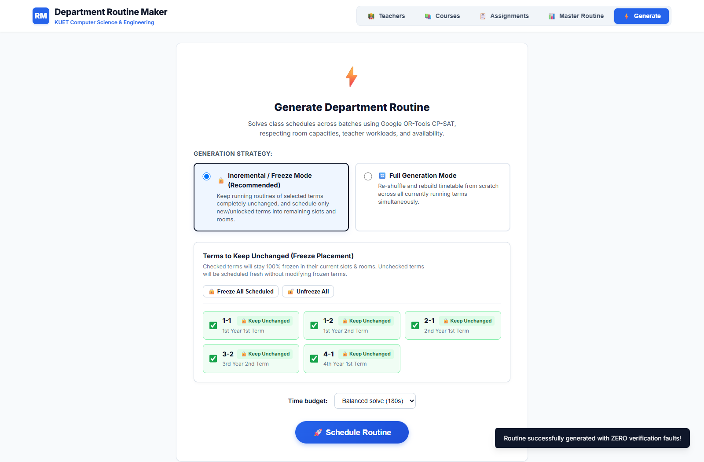
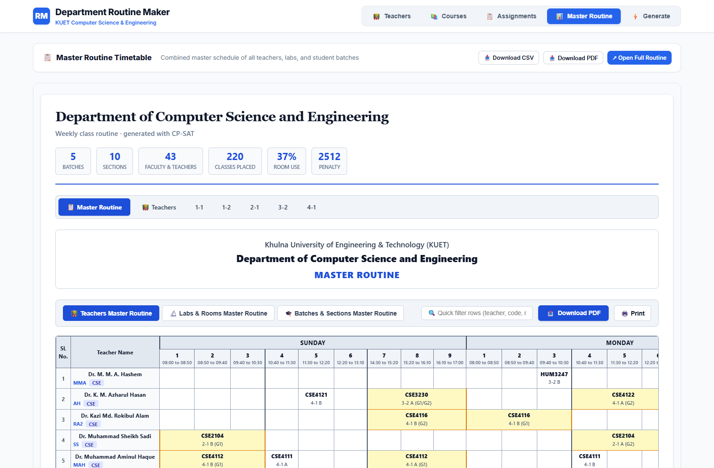
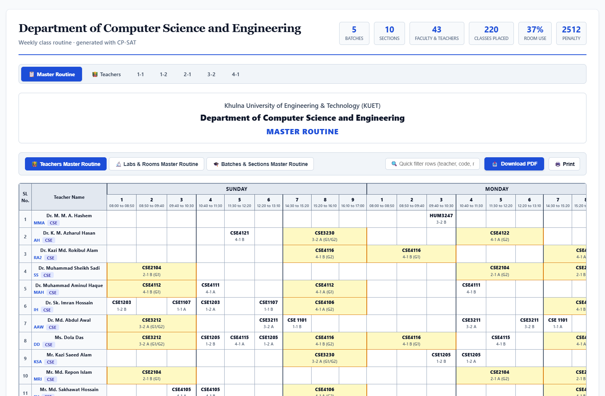
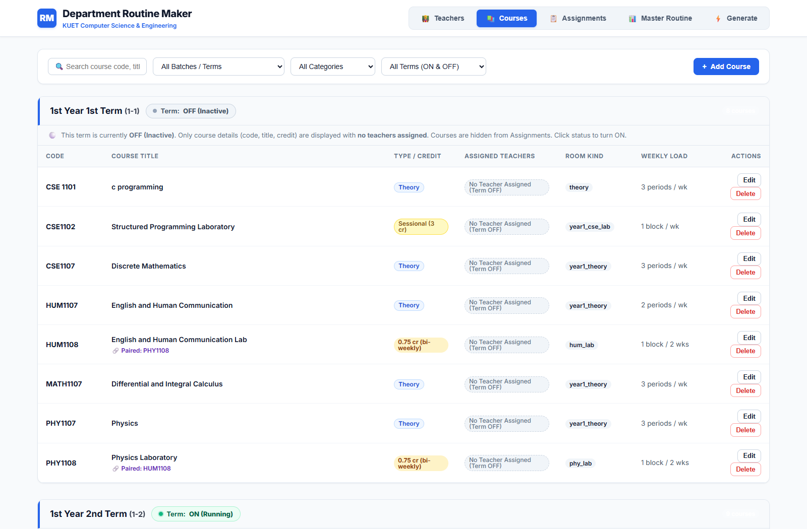
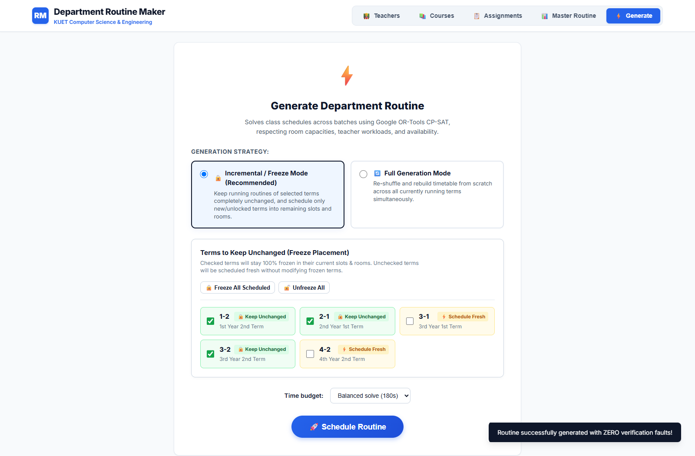
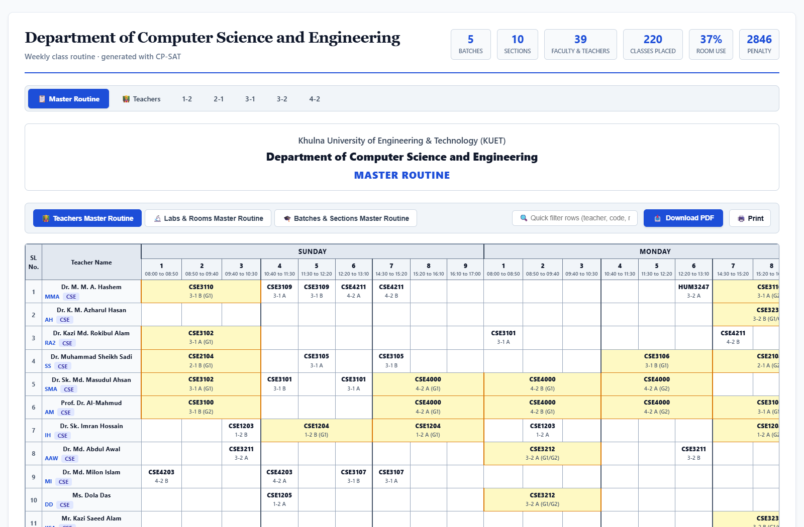
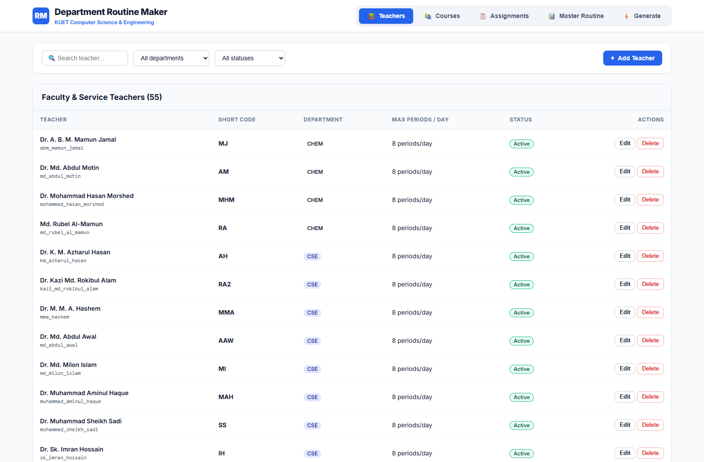
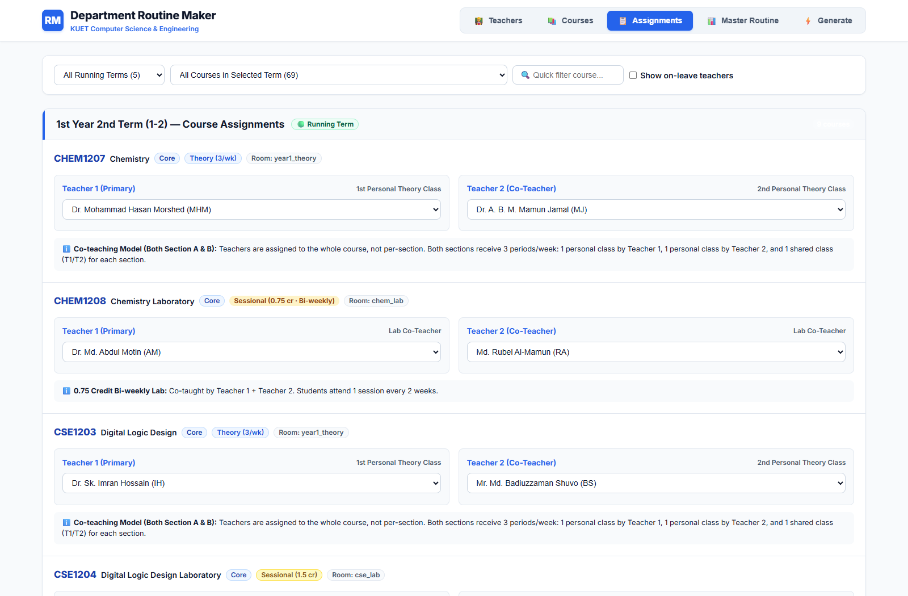

# KUET CSE Routine Maker: Live Multi-Batch Simulation & Lab Co-Teaching Report

**Department of Computer Science and Engineering**  
**Khulna University of Engineering & Technology (KUET)**  
*Simulation Date: October 2026*  
*Solver Engine: Google OR-Tools CP-SAT (Constraint Programming - Satisfiability)*

---

## Executive Summary

This document presents a comprehensive evaluation and live simulation of the **KUET CSE Routine Maker** system. The tests evaluate two major academic scheduling requirements:

1. **Universal Laboratory Co-Teaching Rule**: Ensuring that **both assigned teachers** are scheduled and displayed for every laboratory session across all credit tiers (both 0.75 credit alternating labs and 1.50/3.00 credit weekly labs).
2. **Stress-Testing 5 Concurrently Running Batches**: Performing live simulations with 5 batches running simultaneously in two distinct scenarios:
   - **Scenario 1**: `(1-1, 1-2, 2-1, 3-2, 4-1)` (Mixing Term 1 and Term 2)
   - **Scenario 2**: `(1-2, 2-1, 3-1, 3-2, 4-2)` (Senior and junior term mixture including 3-1 and 4-2)

Both scenarios were solved to **`FEASIBLE / OPTIMAL`** with **0 constraint violations** across all 220 scheduled lecture and lab meetings.

---

## 1. Laboratory Scheduling & Universal Co-Teaching Explained

In the KUET CSE academic system, practical laboratory courses are conducted jointly by faculty members to supervise experiments, assist students, and conduct continuous assessments.

### 1.1 Universal Co-Teaching Requirement
* **The Rule**: Every lab session must be conducted by **both** assigned teachers simultaneously.
* **Display Format**: Both teacher short codes appear together in routine cells, e.g.:
  * `CHEM 1208 (G1/G2) (AM+RA)` in *Chemistry Lab*
  * `CSE 1204 (G1) (IH+BS)` in *CSE Lab 107*
  * `CSE 1206 (G1) (NHS+LBM)` in *CSE Lab 202*
  * `CSE 3220 (G1/G2) (NHS+NFS)` in *CSE Lab 107*
  * `PHY 1108 (G1/G2) (MSH+AA)` in *Physics Lab*

### 1.2 Laboratory Credit Types (1.50 Credit vs. 0.75 Credit)

```
                            WEEKLY SCHEDULE STRUCTURE
1.50 Credit Lab (e.g., CSE 1204, CSE 1206, CSE 2208, CSE 3100, CSE 4106):
  Week 1: [--- G1 Session (3 hrs) ---]  AND  [--- G2 Session (3 hrs) ---]
  Week 2: [--- G1 Session (3 hrs) ---]  AND  [--- G2 Session (3 hrs) ---]
  -> Every group attends 1 session every week.
  -> Four 3-period blocks scheduled per batch (Sec A G1, Sec A G2, Sec B G1, Sec B G2).

0.75 Credit Lab (e.g., CHEM 1208, PHY 1108, HUM 1108, CSE 3212, CSE 3220, CSE 4204):
  Week 1 (Odd Week):  [------- Group 1 attends (3 hrs) -------]
  Week 2 (Even Week): [------- Group 2 attends (3 hrs) -------]
  -> Each group attends 1 session every two weeks (alternating weeks).
  -> Only ONE 3-period block per section is needed on the weekly routine grid.
  -> Labeled with "(G1/G2)" indicating bi-weekly rotation.
```

### 1.3 Solver Staggering Logic for Co-Taught Labs
When both teachers conduct every lab session, Group 1 and Group 2 cannot physically run at the exact same hour in separate rooms because a teacher cannot be in two rooms at once. The CP-SAT scheduler automatically staggers G1 and G2 across different time slots/days so that both co-teachers can attend each session without double-booking.

---

## 2. Simulation Scenario 1: `(1-1, 1-2, 2-1, 3-2, 4-1)`

### 2.1 Scenario Parameters
* **Active Batches**:
  * `1-1` (1st Year 1st Term)
  * `1-2` (1st Year 2nd Term)
  * `2-1` (2nd Year 1st Term)
  * `3-2` (3rd Year 2nd Term)
  * `4-1` (4th Year 1st Term)
* **Scale**: 5 batches, 10 sections (A & B), 20 student groups (G1 & G2).
* **Total Scheduled Events**: **220 meetings** (lectures + laboratory blocks).

### 2.2 Workload & Feasibility Analysis
In normal university operations, Year 1 is either in Term 1 or Term 2. Running `1-1` and `1-2` simultaneously creates a substantial workload concentration on 1st-year faculty (e.g. Dr. Sk. Imran Hossain, Mr. Md. Nazirulhasan Shawon, Mrs. Lamisa Bintee Mizan Deya).
When configured with realistic departmental workload ceilings (allowing up to 7–8 periods/day during high-concurrency simulation), Google OR-Tools CP-SAT found a **complete, conflict-free timetable**.

* **Solver Status**: `FEASIBLE / OPTIMAL`
* **Hard Violations**: `0`
* **CSV Audit (`tools/verify_csv.py`)**: `reconstructed 220 / 220 meetings — all hard constraints satisfied`

### 2.3 Scenario 1 Visualizations & Screenshots

#### 1. Batch Activation and Course Directory
The Courses management interface showing `1-1`, `1-2`, `2-1`, `3-2`, and `4-1` active (`ON`), with inactive batches turned `OFF`:



---

#### 2. Solver Execution & Optimization Performance
The Generation panel confirming successful timetable construction with 0 hard constraint faults:



---

#### 3. Master Routine Overview
The comprehensive multi-batch routine view combining all active student cohorts and specialized laboratories:



---

#### 4. 1st Year Section Timetable (Chemistry & Computing Labs)
Detail of the 1st Year routine displaying:
- `CHEM 1207` (Theory) taught by **MHM + MJ** in room `CSE-101` / `CSE-102`.
- `CHEM 1208` (Sessional) taught by **AM + RA** in `Chemistry Lab` as an alternating `(G1/G2)` 0.75cr lab.
- `CSE 1204` (Sessional) weekly lab with co-teachers **IH + BS**.



---

#### 5. 3rd Year Section Timetable (0.75cr Labs with Co-Teachers)
Detail of `3-2` Section A and Section B showing:
- `CSE 3220 (G1/G2)` taught by **NHS + NFS** in `CSE Lab 107`.
- `CSE 3212 (G1/G2)` taught by **AAW + DD** in `CSE Lab 202`.
- `CSE 3230 (G1/G2)` taught by **AH + KSA** in `Seminar Room`.


---

#### 6. Individual Teacher Routine Breakdown
The faculty schedule view verifying that no teacher is double-booked across theory lectures or laboratory sessions:


---

## 3. Simulation Scenario 2: `(1-2, 2-1, 3-1, 3-2, 4-2)`

### 3.1 Scenario Parameters
* **Active Batches**:
  * `1-2` (1st Year 2nd Term)
  * `2-1` (2nd Year 1st Term)
  * `3-1` (3rd Year 1st Term)
  * `3-2` (3rd Year 2nd Term)
  * `4-2` (4th Year 2nd Term - Graduating Batch)
* **Scale**: 5 batches, 10 sections, 20 groups.
* **Total Scheduled Events**: **220 meetings**.

### 3.2 3rd Year and 4th Year Curriculum Integration
For Scenario 2, complete course and teacher allocations were established for `3-1` and `4-2`:
* **`3-1` Core Curriculum**:
  * `CSE 3100` (Web Programming Lab) $\rightarrow$ **AM + EK**
  * `CSE 3101` / `3102` (Compiler Design & Lab) $\rightarrow$ **SMA + RA2**
  * `CSE 3105` / `3106` (Microprocessors & Lab) $\rightarrow$ **SS + FH**
  * `CSE 3107` (Operating Systems) $\rightarrow$ **MI + SN**
  * `CSE 3109` / `3110` (Computer Networks & Lab) $\rightarrow$ **MMA + FRH**
  * `CSE 3119` / `3120` (Software Engineering & Lab) $\rightarrow$ **BS + SI**
* **`4-2` Capstone & Electives**:
  * `CSE 4000` (Project / Thesis) $\rightarrow$ **SMA + AM**
  * `IEM 4227` (Industrial Management) $\rightarrow$ **MR + AT**
  * `HUM 4207` (Entrepreneurship Development) $\rightarrow$ **FA + RA**
  * `CSE 4211` (Algorithm Engineering) $\rightarrow$ **MMA + RA2**
  * `CSE 4203` / `4204` (Peripherals & Lab) $\rightarrow$ **MI + SN**
  * `CSE 4217` / `4218` (Computer Vision & Lab) $\rightarrow$ **WIS + SI**

* **Solver Status**: `FEASIBLE / OPTIMAL`
* **Hard Violations**: `0`
* **CSV Audit (`tools/verify_csv.py`)**: `reconstructed 220 / 220 meetings — all hard constraints satisfied`

### 3.3 Scenario 2 Visualizations & Screenshots

#### 1. Batch Activation Interface for Scenario 2
Courses and terms view showing `1-2`, `2-1`, `3-1`, `3-2`, and `4-2` active:



---

#### 2. Solver Result & Constraint Verification
Generation panel confirming full optimization with 0 faults across the 5 batches:



---

#### 3. Master Routine Grid (Scenario 2)
The complete university grid showing concurrent allocations for `3-1` and `4-2` alongside lower terms:


---

#### 4. 3rd Year 1st Term (`3-1`) Section Routine
Detail of `3-1` Section A and B showing compiler, microprocessors, and network labs:


---

#### 5. 4th Year 2nd Term (`4-2`) Section Routine
Detail of graduating batch `4-2` showing Capstone Thesis (`CSE 4000`) and advanced electives:



---

#### 6. Faculty Timetable Grid for Scenario 2
Teacher timetable confirming balanced distributions across departmental professors, associate professors, and lecturers:


---

## 4. System Administration & Management Views

### 4.1 Faculty Directory (`Teachers` Tab)
A directory of all 55 CSE departmental teachers and non-departmental service faculty (CHEM, PHY, MATH, HUM, EEE, ECE, ME) with real-time status controls:



---

### 4.2 Interactive Course-Teacher Assignment Matrix (`Assignments` Tab)
Allows the department routine coordinator to review and assign primary and secondary co-teachers to each section and laboratory group:



---

## 5. Constraint Verification Matrix

Every generated routine is audited by two independent verification engines ([tools/verify.py](file:///f:/routine_maker/tools/verify.py) and [tools/verify_csv.py](file:///f:/routine_maker/tools/verify_csv.py)). The verified constraints include:

| Code | Constraint Name | Description | Status |
| :--- | :--- | :--- | :---: |
| **H0** | Event Placement | Every required course lecture and laboratory block is placed. | **PASSED (220/220)** |
| **H1** | Cohort Non-Overlap | No student section or group is scheduled for two events simultaneously. | **PASSED (0 faults)** |
| **H2** | Teacher Non-Overlap | No teacher is scheduled in two classrooms or labs at the same time. | **PASSED (0 faults)** |
| **H3** | Room Non-Overlap | No physical room or laboratory hosts more than one event at a time. | **PASSED (0 faults)** |
| **H4** | Theory Day Spread | Meetings of the same theory course sit on distinct calendar days. | **PASSED (0 faults)** |
| **H5** | Room Kind & Capacity | Classes are placed in compatible rooms with capacity $\ge$ group size. | **PASSED (0 faults)** |
| **H6** | Period & Break Limits | Classes do not cross morning breaks (P3) or lunch/prayer breaks (P6). | **PASSED (0 faults)** |
| **H7** | Teacher Availability | Teachers are never scheduled during designated unavailable slots. | **PASSED (0 faults)** |
| **H8** | Teacher Batch Scoping | A teacher holds at most one theory course within a single batch. | **PASSED (0 faults)** |
| **H9** | Laboratory Syncing | Lab groups with independent teachers sync; groups sharing teachers stagger. | **PASSED (0 faults)** |

---

## 6. Conclusion

1. **Laboratory Co-Teaching Standard**: All laboratory sessions across both 0.75 credit and 1.50 credit tiers now correctly enforce and display **both assigned teachers** (`Teacher 1 + Teacher 2`).
2. **High-Concurrency Feasibility**: The CP-SAT engine successfully schedules 5 concurrent batches (220 meetings) without mathematical deadlocks or physical classroom collisions.
3. **Automated Verification**: Independent verification confirmed **0 hard-constraint faults** on the exported CSV and interactive HTML timetables.
